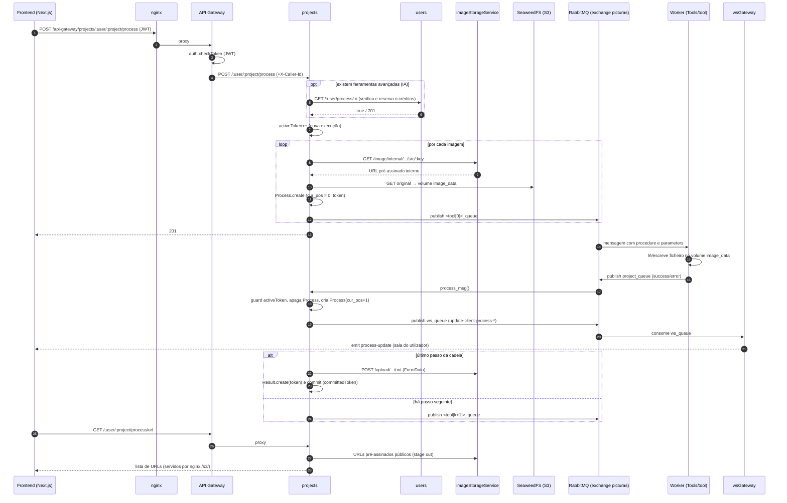
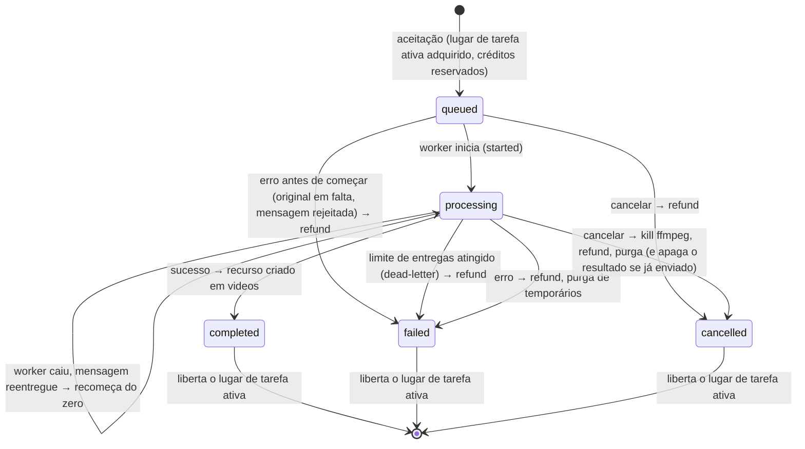
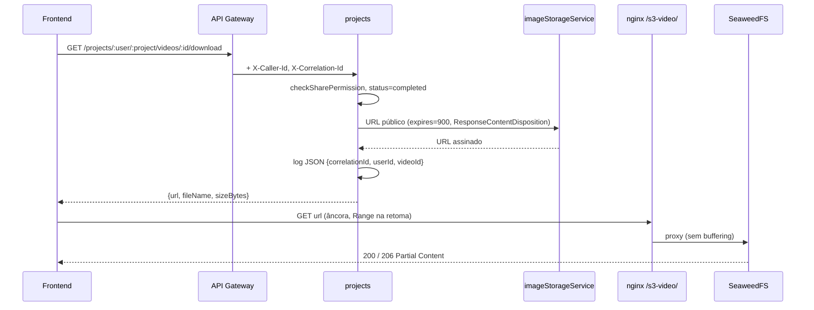
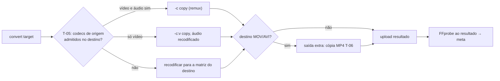
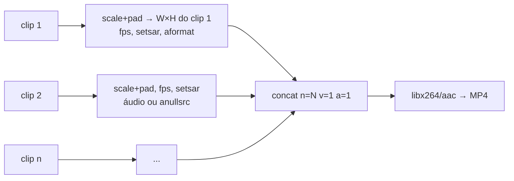
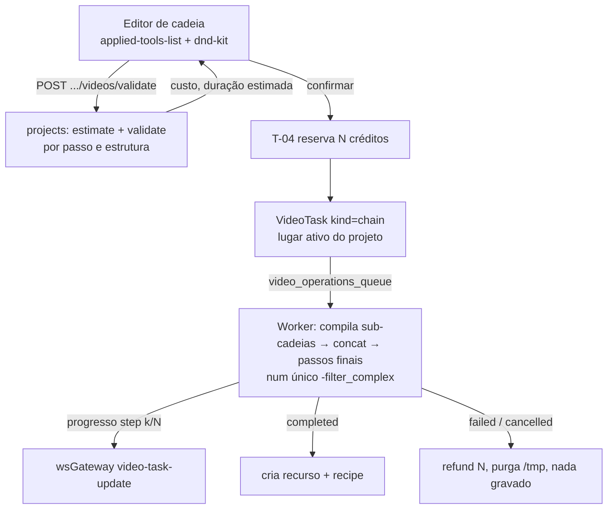

# 🏛️ Architecture Design Document (ADD)
### Fase 1: Suporte a Vídeo no PictuRAS · Decisões de Arquitetura e Implementação (UC-VID-006 a UC-VID-015)

---

## 0. Identificação do Documento

| **Campo** | **Valor** |
|---|---|
| **Grupo / Equipa** | Grupo 27 |
| **Autores** | Equipa PictuRAS-27 |
| **Data** | 2026-10-19 |
| **Versão do documento** | v1.0 (primeira versão do ADD) |
| **Âmbito** | UC-VID-006 a UC-VID-015, requisitos comuns `REQ-VID-COM-006`, `REQ-VID-QUOTA-007/008`, `REQ-VID-STORAGE-002/004`, `REQ-VID-TASK-006/007`, `REQ-VID-UPLOAD-016/017` e não funcionais `REQ-VID-NFR-012` a `016` |
| **Unidade Curricular** | Requisitos e Arquiteturas de Software — MEI, Universidade do Minho |

---

## 1. Introdução

### 1.1 Objetivo

Este documento regista as decisões de arquitetura e de implementação para os dez novos casos de uso de vídeo (UC-VID-006 a UC-VID-015) e para os requisitos comuns e não funcionais introduzidos na ERS v2.3. Para cada requisito, a decisão segue esta ordem de preferência:

1. Reutilizar um componente existente tal como está;
2. Adaptar um componente existente, só por acréscimo e sem alterar o que já existe (ver 2.6);
3. Usar uma biblioteca ou framework que já está no projeto;
4. Introduzir uma biblioteca nova e consolidada (só com justificação);
5. Criar código novo de raiz (só quando nada acima serve).

### 1.2 Âmbito

- **Dentro do âmbito:** o desenho dos componentes e das pipelines necessários para UC-VID-006 a UC-VID-015, incluindo os componentes transversais partilhados (secção 3).
- **Fora do âmbito:** a implementação. Este documento não altera código nem outros documentos.
- **Pré-requisito declarado:** a análise do código (secção 2.5) mostra que **a fundação de vídeo (UC-VID-000 a UC-VID-005) ainda não está implementada**. Os novos casos de uso dependem dela. O T-00 (secção 3) resume o mínimo dessa fundação de que este ADD depende, sem a redesenhar por completo.

### 1.3 Documentos de referência

| **Documento** | **Conteúdo relevante** |
|---|---|
| [`docs/requirements.md`](requirements.md) | ERS v2.3: catálogo de requisitos, tabela de impacto (4.2), DQ-001 a DQ-025 (4.4), Q-ERS-001 a 009 (4.5) |
| [`docs/use-cases.md`](use-cases.md) | Índice dos casos de uso v1.4 |
| [`docs/use-cases/UC-VID-006.md`](use-cases/UC-VID-006.md) a [`UC-VID-015.md`](use-cases/UC-VID-015.md) | Fluxos, exceções, regras de negócio, assunções e questões dos novos casos de uso |
| [`docs/use-cases/UC-VID-000.md`](use-cases/UC-VID-000.md) a [`UC-VID-005.md`](use-cases/UC-VID-005.md) | Fundação de vídeo (pré-requisito) |
| [`docs/requirements/`](requirements/) | `REQ-VID-COM`, `DOWNLOAD`, `INFO`, `ADJUST`, `FILTER`, `RESIZE`, `ORIENT`, `CONVERT`, `CONCAT`, `CHAIN`, `BATCH`, `NFR`, `UPLOAD` |
| `README.md` | Descrição da arquitetura de microsserviços e das funcionalidades existentes |
| `docker-compose.yaml` | Topologia de serviços, volumes e redes |

---

## 2. Arquitetura Atual

### 2.1 Componentes

| **Componente** | **Pasta / imagem** | **Responsabilidade atual** |
|---|---|---|
| Reverse proxy | `nginx/nginx.conf` (`nginx:latest`) | Termina TLS (porta 8080 do host → 443) e encaminha `/` → frontend, `/api-gateway/` → API Gateway, `/socket.io` → WS Gateway, `/s3/` → SeaweedFS (URLs pré-assinados públicos), `/s3-console/` → interface web do SeaweedFS (porta 8888) |
| Frontend | `frontend/` (Next.js) | Editor de projetos de imagem: toolbar de ferramentas (`components/toolbar/`), lista de ferramentas aplicadas ordenável (`applied-tools-list.tsx`, `sortable-tool-item.tsx`), predefinições (`components/presets/presets-dialog.tsx`), progresso por WebSocket (`app/dashboard/[pid]/page.tsx`) |
| API Gateway | `apiGateway/` | Valida o JWT (`auth/auth.js`) e reencaminha pedidos para os serviços (`routes/projects.js`, `users.js`, `subscriptions.js`), propagando `Authorization` e `X-Caller-Id` |
| Serviço de Projetos | `projects/` | Gestão de projetos, imagens e ferramentas; orquestração do processamento (`routes/projects.js`); partilha (`middleware/shareAuth.js`); controlo de versão otimista (`middleware/projectVersion.js`); presença de editores (`middleware/enforcePresenceLimit.js`); cache de pré-visualizações (`models/previewCache.js`, `utils/cacheKey.js`) |
| Serviço de Utilizadores | `users/` | Contas, tipo de utilizador (`anonymous`, `free`, `premium`), quota diária (`routes/users.js`: `GET /:user/process/:n`, `POST /:user/process/refund/:n`), predefinições de ferramentas (`models/preset.js`, `routes/presets.js`) |
| Serviço de Subscrições | `subscriptions/` | Planos e cartões |
| Armazenamento de objetos | `imageStorageService/` + `seaweedfs` (`chrislusf/seaweedfs:4.47`) | Upload, cópia, remoção e URLs pré-assinados (`services/getPresignedUrl.js`) num bucket por utilizador (`user-<id>`) com chaves `<projectId>/<stage>/<uuid>.<ext>`; estágios permitidos em `utils/stages.js`: `src`, `preview`, `preview_cache`, `out` |
| Broker | `rabbitMQ/` (`rabbitmq:4.0.5-management`) | Exchange direta `picturas`; uma fila por ferramenta (`<tool>_queue`), `project_queue` (respostas dos workers) e `ws_queue` (notificações), declaradas em `rabbitMQ/definitions.json`. A `scale_queue` está declarada e mapeada (`projects/utils/project_msg.js`, `Tools/utils/tool_msg.py`, `frontend/lib/tool-types.ts`), mas não tem worker em `Tools/`, serviço no `docker-compose.yaml` nem componente na toolbar |
| Workers de imagem | `Tools/<tool>/` | Um contentor Python por ferramenta; consomem a sua fila, leem e escrevem ficheiros no volume partilhado `image_data` e respondem em `project_queue`. Utilitários comuns em `Tools/utils/` (`rabbit_mq.py`, `tool_msg.py`, `img_handler.py`, `env.py`) |
| Worker de marca de água | imagem externa `prcsousa/picturas-watermark-tool-ms:latest` | Consome `watermark_queue`; **o código-fonte não está neste repositório** |
| Mock generativo | `generative-mock/` | API local que simula o Stable Diffusion WebUI para `expand_ai` |
| WS Gateway | `wsGateway/` | Socket.IO; autentica o JWT na ligação e junta o socket à sala do utilizador (emite `authError` se o token for inválido); o socket entra na sala `project:<id>` só quando o cliente envia `join-project` e sai com `leave-project`; consome `ws_queue` e emite `preview-ready`, `preview-error`, `process-update`, `process-error`, `project-op`, `project-updated` |
| Bases de dados | `projects_mongoDB`, `users_mongoDB`, `subscriptions_mongoDB` (`mongo:4.4`) | Persistência por serviço; cópia diária com `mongodump` (`mongo-backup`) |

### 2.2 Pipeline de processamento atual (imagem)

O processamento de imagem já é um **executor de cadeias orientado a mensagens**: as ferramentas do projeto (`project.tools`, ordenadas por `position`) são aplicadas a cada imagem, uma ferramenta de cada vez, e o orquestrador em `projects/routes/projects.js` (`process_msg`) avança para o passo seguinte quando o worker responde.



Mecanismos existentes relevantes para os novos requisitos:

| **Mecanismo** | **Onde** | **Como funciona** |
|---|---|---|
| Cancelamento por *token* | `projects/routes/projects.js` (`DELETE /:user/:project/process`, guard em `process_msg`) | O cancelamento incrementa `activeToken`; respostas de workers com outro `token` são ignoradas; os `Result` do token cancelado são apagados e os créditos pendentes devolvidos. Os workers **não** são interrompidos. |
| Reserva e devolução de quota com N créditos | `users/routes/users.js` (`GET /:user/process/:n`, `POST /:user/process/refund/:n`, `check_process`) | A reserva já aceita N créditos; para `premium` é sempre aceite; `FREE_DAILY_OP=5` em `docker-compose.yaml`. A reserva **é** o débito: não existe um passo de confirmação separado. |
| Pré-visualização assíncrona | `POST /:user/:project/preview/:img` | Corre a cadeia completa numa imagem via workers e responde por WebSocket (`preview-ready`); cache por `sha256` da imagem e das ferramentas (`utils/cacheKey.js`). |
| Pré-visualização síncrona com `sharp` | `applyToolsPreview` em `projects/routes/projects.js` | Aplica brilho (`modulate`), saturação (`modulate`) e contraste (`linear(c, 128·(1−c))`) num buffer em memória, sem workers. Usado pelo assistente de IA. |
| Descarregamento em ZIP | `GET /:user/:project/process` | Descarrega os resultados para disco temporário e gera um ZIP em memória com `jszip`. No frontend, `lib/projects.ts` (`downloadProjectImages`) também gera ZIPs no navegador. |
| Predefinições de cadeias | `users/models/preset.js`, `users/routes/presets.js`, `frontend/components/presets/presets-dialog.tsx` | Guardam `[{procedure, params}]` por utilizador com nome único e partilha por link. |
| Permissões de partilha | `projects/middleware/shareAuth.js` | `checkSharePermission` (leitura) e `requireEditPermission` (edição). |
| Notificações de co-edição | `send_msg_project_op` em `projects/utils/project_msg.js` | Eventos `project-op` para a sala `project:<id>`. |

### 2.3 Pipelines de build, CI/CD e deploy

| **Aspeto** | **Estado atual** |
|---|---|
| CI/CD | **Não existe.** A pasta `.github/` contém apenas `agents/` e `prompts/` do specsmd; não há `.github/workflows/`. Não existem testes automáticos nos serviços (`wsGateway/package.json` tem `"test": "echo \"Error: no test specified\""`). |
| Build | Cada serviço tem o seu `Dockerfile`; os workers de imagem usam `Tools/` como contexto (`dockerfile: <tool>/Dockerfile`) e copiam `Tools/utils/`. O frontend faz `bun run build` na imagem. |
| Deploy | `docker compose up` numa única máquina, rede `elk`, volumes nomeados (`image_data`, `seaweedfs_data`, `rabbitmq_data`, `project_data`, `user_data`, `subscription_data`). O stack ELK está comentado em `docker-compose.yaml`; os logs vão apenas para `stdout`. |
| Configuração | Variáveis de ambiente em `docker-compose.yaml` (credenciais RabbitMQ e S3, `JWT_SECRET_KEY`, `FREE_DAILY_OP`) e `.env.example`. |

### 2.4 Stack tecnológico

| **Framework / biblioteca** | **Versão** | **Onde é usado** |
|---|---|---|
| Next.js | 15.1.3 | `frontend/package.json` |
| React / React DOM | ^19.0.0 | `frontend/package.json` |
| TypeScript | ^5 | `frontend/package.json` |
| Tailwind CSS | ^3.4.1 | `frontend/package.json` |
| @tanstack/react-query | ^5.63.0 | `frontend/lib/queries/`, `frontend/lib/mutations/` |
| socket.io-client | ^4.8.1 | `frontend/lib/queries/projects.ts` (`useGetSocket`) |
| @dnd-kit/core / @dnd-kit/sortable | ^6.3.1 / ^10.0.0 | `frontend/components/toolbar/sortable-tool-item.tsx` |
| Radix UI (slider, progress, checkbox, dialog, select, tabs) | ^1.2.2, ^1.1.1, ^1.1.3, ^1.1.4, ^2.1.4, ^1.1.2 | `frontend/components/ui/` |
| react-dropzone | ^14.3.5 | `frontend/components/app-dropzone.tsx` |
| jszip | ^3.10.1 | `frontend/lib/projects.ts`, `frontend/lib/utils.ts`, `projects/routes/projects.js` |
| Bun / Node (frontend) | 1.1.32 / `node:18` | `frontend/.tool-versions`, `frontend/Dockerfile` |
| Express | ~4.16.1 (projects, users, apiGateway), ^4.21.2 (imageStorageService, wsGateway) | `*/package.json` |
| Mongoose | ^8.9.3 | `projects/`, `users/` |
| amqplib | ^0.10.5 | `projects/utils/rabbit_mq.js`, `wsGateway/utils/rabbit_mq.js` |
| sharp | ^0.33.0 | `projects/routes/projects.js` (`applyToolsPreview`) |
| multer | ^1.4.5-lts.1 (`memoryStorage`) | `apiGateway/`, `projects/`, `imageStorageService/` |
| uuid | ^11.0.5 | `projects/` |
| jsonwebtoken | ^9.0.x | `apiGateway/`, `projects/`, `users/`, `wsGateway/` |
| aws-sdk (JavaScript v2) | ^2.1692.0 | `imageStorageService/services/s3Client.js` |
| socket.io | ^4.8.1 | `wsGateway/index.js` |
| Node (backend) | `node` sem versão fixa (`node:18` no wsGateway) | `*/Dockerfile` |
| Python | 3.11-slim (3.10 em `expand_ai`) | `Tools/*/Dockerfile` |
| pika | 1.3.2 | `Tools/utils/rabbit_mq.py` |
| Pillow | 11.0.0 | `Tools/*/requirements.txt` (`ImageEnhance` em `brightness`, `contrast`, `saturation`) |
| opencv-python-headless | 4.10.0.84 | ferramentas de IA |
| requests | 2.32.3 | `Tools/expand_ai/requirements.txt` |
| RabbitMQ | 4.0.5-management | `rabbitMQ/Dockerfile` |
| MongoDB | 4.4 | `docker-compose.yaml` |
| SeaweedFS | 4.47 | `docker-compose.yaml` |
| nginx | latest | `docker-compose.yaml` |
| FFmpeg / FFprobe | **não existe no projeto** | — |

### 2.5 Estado das operações de vídeo (UC-VID-000 a UC-VID-005) e das ferramentas de imagem

**Vídeo.** Uma pesquisa por `video`, `ffmpeg` e `mp4` em todo o código (excluindo `docs/`, `memory-bank/`, `Documentos consulta/` e a configuração do specsmd) não devolve resultados. Os UC-VID-000 a UC-VID-005 estão **especificados mas não implementados**. Em concreto, não existem:

- modelo de recurso de vídeo no MongoDB, rotas de vídeo no API Gateway ou no serviço de projetos;
- fila `video_operations_queue` em `rabbitMQ/definitions.json`;
- workers com FFmpeg, nem FFmpeg em nenhum `Dockerfile`;
- leitor de vídeo, componentes de vídeo ou validação de MIME de vídeo no frontend;
- estágios de armazenamento para vídeo em `imageStorageService/utils/stages.js`.

Por isso, o recorte, o áudio, a velocidade, a marca de água e a extração de fotogramas **não podem ser reutilizados**: têm de ser construídos (T-00), e os novos casos de uso assentam nessa construção.

**Ferramentas de imagem que servem de referência:**

| **Ferramenta** | **Implementação** | **Parâmetros** | **O que se aproveita para vídeo** |
|---|---|---|---|
| Brilho | `Tools/brightness/brightness.py` (`ImageEnhance.Brightness`) | `brightness` ∈ [0, 2], neutro 1 (`frontend/lib/tool-types.ts`) | Semântica e nome do parâmetro (DQ-020); UI `frontend/components/toolbar/brightness-tool.tsx` |
| Contraste | `Tools/contrast/contrast.py` (`ImageEnhance.Contrast`) | `contrastFactor` ∈ [0, 2] | Semântica; UI `contrast-tool.tsx` |
| Saturação | `Tools/saturation/saturation.py` (`ImageEnhance.Color`) | `saturationFactor` ∈ [0, 2] | Semântica; UI `saturation-tool.tsx` |
| Redimensionamento | `Tools/resize/resize.py` (`Image.resize`) | `width`, `height` | Nomes dos parâmetros; UI `resize-tool.tsx` |
| Rotação | `Tools/rotate/rotate.py` (`Image.rotate(expand=True)`) | `degrees` ∈ [0, 360] | UI `rotate-tool.tsx` (o vídeo restringe a 90/180/270 e acrescenta espelho) |
| Reflexão (espelho) | **não existe** como ferramenta de imagem | — | Nada a reutilizar |
| Marca de água | imagem externa `prcsousa/picturas-watermark-tool-ms` | `{}` em `watermark-tool.tsx` | Nada (código não disponível) |
| Estrutura comum dos workers | `Tools/utils/tool_msg.py`, `Tools/utils/rabbit_mq.py`, `Tools/utils/env.py` | — | Ligação ao RabbitMQ (classe `Rabbit_MQ`) e leitura do ambiente (`env.py`). Do `tool_msg.py` aproveitam-se só os nomes dos campos (`messageId`, `correlationId`, `status`, `output`, `error`, `metadata.processingTime`): a classe `ToolMSG` tem as filas fixas e responde sempre em `project_queue` |

### 2.6 Regra de evolução: só acrescentar

Todo o código existente fica como está. A funcionalidade de vídeo reutiliza-o e acrescenta código novo, mas **nunca altera o que já está feito**.

- **Permitido:**
  - ficheiros novos (modelos, rotas, serviços, workers, componentes);
  - pontos de ligação novos em ficheiros existentes, sem tocar nas linhas que lá estão. Por exemplo: uma linha `app.use(...)` que monta um router novo, um `require` de um módulo novo, uma fila, uma exchange ou um *binding* novos em `rabbitMQ/definitions.json`, um serviço ou um volume novos no `docker-compose.yaml`, um `location` ou um `log_format` novos no `nginx/nginx.conf`, e componentes novos no frontend.
- **Proibido:**
  - alterar ou apagar linhas existentes;
  - mudar a assinatura ou o comportamento de funções, endpoints, filas ou configuração já usados pelo fluxo de imagem;
  - mudar configuração global que afete os componentes atuais (por exemplo, `rabbitMQ/rabbitmq.conf`).
- **Consequências no desenho:**
  - quando um componente existente não serve tal como está, cria-se um equivalente novo ao lado em vez de o modificar (por exemplo, os estágios e os URLs de vídeo num módulo novo do `imageStorageService`, T-08);
  - um ponto de ligação novo não pode mudar o que já acontece: um router novo montado antes de um existente só responde às rotas de vídeo e deixa passar todos os outros pedidos; o vídeo usa filas próprias e não partilha filas com consumidores existentes;
  - as limitações do código existente que só se resolveriam alterando-o ficam registadas como riscos aceites e como propostas para uma fase posterior (por exemplo, a corrida na reserva de quota, T-04).

Neste documento, **Adaptar** significa reutilizar um padrão existente ou estender um componente por acréscimo, nunca modificar o seu código.

---

## 3. Decisões Transversais

Componentes partilhados por vários casos de uso, desenhados uma única vez. As secções 4.x referenciam-nos pelo identificador **T-xx**. Todas as decisões seguem a regra da secção 2.6.

### T-00 — Pré-requisito: fundação de vídeo mínima

**Decisão: Criar** (não existe nada a reutilizar, ver 2.5). Os UC-VID-006 a 015 precisam, no mínimo, de:

| **Elemento** | **Desenho** | **Requisitos** |
|---|---|---|
| Coleção `videos` (MongoDB do serviço de projetos) | Novo modelo `projects/models/video.js`, separado de `project.imgs` | REQ-VID-STORAGE-001 a 004, REQ-VID-UPLOAD-013, REQ-VID-UPLOAD-019, REQ-VID-INFO-007/008 |
| Estágios de armazenamento de vídeo | Lista própria em `imageStorageService/utils/videoStages.js` (ficheiro novo; `stages.js` não muda): `video_src`, `video_out`, `video_preview`, `video_thumb`, `video_zip` (ver T-08) | REQ-VID-UPLOAD-007, 014, 016; REQ-VID-BATCH-015 |
| Worker de vídeo com FFmpeg | `Tools/video/` (ver T-02) | REQ-VID-NFR-010, 011 |
| Filas de vídeo | Entradas novas em `rabbitMQ/definitions.json`: `video_operations_queue` (pedidos ao worker; fila *quorum* com limite de entregas, T-03), `video_project_queue` (respostas do worker ao serviço de projetos), `video_ws_queue` (eventos para o wsGateway), com os respetivos *bindings* na exchange `picturas`, e a exchange *fanout* `video_control` (cancelamento, T-03). O vídeo não usa `project_queue` nem `ws_queue`, porque essas filas já têm consumidores (`process_msg` no serviço de projetos e no wsGateway): uma mensagem de vídeo seria lida, e consumida, pelo código existente | REQ-VID-NFR-011 |
| Tarefas de vídeo | Modelo `VideoTask` (ver T-03) | REQ-VID-TASK-001 a 007 |
| Lugar de tarefa ativa | Coleção `video_project_locks` com índice único em `project_id` (ver T-03) | REQ-VID-NFR-021, DQ-016 |
| Lotes | Modelo `VideoBatch` (ver T-09) | REQ-VID-TASK-007, REQ-VID-BATCH-008 |
| Rotas de vídeo | Routers novos `apiGateway/routes/videos.js` e `projects/routes/videos.js`, cada um montado com uma linha `app.use` nova colocada antes do router existente (`/projects` no gateway, `/` no serviço de projetos). Só respondem a caminhos `/:user/:project/videos…` e passam os restantes pedidos ao router seguinte, pelo que as URLs mantêm a forma das de imagem (`/projects/:user/:project/videos/…`) e as rotas existentes não mudam. Reutilizam `auth.checkToken` (`apiGateway/auth/auth.js`, que valida o JWT e confirma que o utilizador do token é o `:user` do caminho, exceto com `?share=`) e os *middlewares* `checkSharePermission`, `requireEditPermission` e `enforcePresenceLimit` do serviço de projetos. Não usam `requireProjectVersion`: as operações de vídeo não alteram o documento do projeto (ver abaixo), e exigir `X-Project-Version` daria 409 sem motivo | Todos os UC-VID |
| Eventos de vídeo no WebSocket | Módulo novo `wsGateway/video.js`, carregado por uma linha nova no fim de `wsGateway/index.js` que lhe passa o `io`; consome `video_ws_queue` (com `wsGateway/utils/rabbit_mq.js`) e emite para as salas que o código existente já gere (ver T-03) | REQ-VID-TASK-003, REQ-VID-NFR-009 |
| Limpeza de projetos apagados | A rota existente `DELETE /:user/:project` só apaga o documento do projeto (nem os ficheiros de imagem apaga) e não pode ser alterada. Os vídeos, tarefas, lotes, lugares de tarefa ativa e objetos no storage de um projeto que já não existe são removidos pela rotina periódica nova do serviço de projetos (Q-ADD-14), que procura `project_id` sem projeto correspondente. Cobre também a remoção de contas (`DELETE /:user`) | REQ-VID-NFR-007 |
| Ingestão | FFprobe extrai metadados; geração de miniatura, de fotograma de pré-visualização e, para MOV/AVI, da cópia MP4 (T-06) | REQ-VID-UPLOAD-008 a 017 |

Esquema proposto para a coleção `videos` (campos usados pelos novos casos de uso):

| **Campo** | **Tipo** | **Uso** |
|---|---|---|
| `_id`, `project_id`, `owner_id`, `created_by` | ObjectId | Identidade, permissões (STORAGE-003), quota do executor (QUOTA-006). `owner_id` é uma cópia do dono do projeto (`project.user_id`), guardada para chegar ao bucket `user-<id>` sem ler o projeto; `created_by` é quem executou a operação |
| `original_name` | String | Nome sugerido no descarregamento (DOWNLOAD-005) |
| `status` | `queued \| processing \| completed \| failed` | Disponibilidade para descarregar e consultar (DOWNLOAD-003, INFO Exceção 3). `queued`, `processing` e `failed` só se aplicam à ingestão: os vídeos resultantes são criados já `completed` quando a tarefa termina, e o estado da operação vive no `VideoTask` (T-03) |
| `storage.original_key`, `storage.preview_key`, `storage.thumb_key`, `storage.first_frame_key` | String | Ficheiro armazenado, cópia MP4 (DQ-012), miniatura, fotograma 0 para pré-visualizações (T-07) |
| `meta.container`, `meta.video_codec`, `meta.audio_codec` (ou `null`) | String | Formato (INFO-004, CONVERT-001) |
| `meta.width`, `meta.height`, `meta.rotation`, `meta.display_width`, `meta.display_height` | Number | Resolução apresentada (INFO-003, UC-VID-011 Q2). As dimensões codificadas (`width`, `height`) servem o FFmpeg; as de apresentação são calculadas na ingestão a partir delas e de `rotation` |
| `meta.fps_num`, `meta.fps_den`, `meta.duration_ms`, `meta.size_bytes`, `meta.bitrate` | Number | INFO-002/005/006, validação de passos (CHAIN-003), pré-validação de lotes (BATCH-004) |
| `source_video_ids` | [ObjectId] | Proveniência (STORAGE-002), ordenada; um único elemento quando há só uma origem e vazio para originais carregados |
| `recipe` | `[{operation, version, parameters}]` | Descrição dos passos (STORAGE-004, INFO-008) |
| `task_id`, `batch_id` | ObjectId | Ligação à tarefa e ao lote. `batch_id` é uma cópia do valor da tarefa, guardada para listar os resultados de um lote (ZIP) sem passar pelas tarefas |

A presença de áudio deriva de `meta.audio_codec != null`, sem campo próprio. Os nomes seguem o *snake_case* dos modelos atuais (`user_id`, `project_id`); a ERS escreve `sourceVideoId`/`sourceVideoIds`, que correspondem a `source_video_ids`. As datas de criação e de atualização vêm da opção `timestamps` do Mongoose.

**Porquê uma coleção separada e não `project.imgs`:**

- A tabela de impacto 4.2 da ERS pede um "esquema específico para recursos de vídeo (`videos`)".
- Os metadados técnicos, a receita e a proveniência de cada vídeo fariam crescer o documento do projeto, que é lido e reescrito em quase todas as rotas.
- Os vídeos precisam de índices e consultas próprias (por projeto, por lote e por vídeo de origem).
- Cada vídeo pode ser atualizado de forma atómica, sem reescrever o array `imgs` nem passar pelo controlo de versão do projeto (`updateIfVersion`, que incrementa `version`). As atualizações vindas dos workers já hoje usam `updateRaw`, que não altera a versão (`projects/routes/projects.js`, `process_msg`).

### T-01 — Contrato uniforme de operação (REQ-VID-COM-006)

**Decisão: Criar**, seguindo o padrão `{procedure, params}` já usado em `project.tools` e em `users/models/preset.js`, com os nomes `operation`/`parameters` fixados pela REQ-VID-COM-006.

- **Contrato:** cada passo é `{ operation, version, parameters }`. O campo `version` (começa em 1) identifica a versão dos parâmetros da operação: como as receitas ficam guardadas (`recipe`, predefinições de cadeia em CHAIN-014), o registo usa-o para migrar receitas antigas ou rejeitá-las com uma mensagem clara quando um parâmetro muda. Uma operação isolada é uma cadeia com um passo; uma cadeia tem N passos; um lote aplica a mesma cadeia a vários vídeos. A junção é um passo como os outros, com os clips dentro de `parameters`: `{ operation: "concat", parameters: { clips: [{ videoId, steps: [...] }] } }`. Os nomes dos `parameters` seguem o camelCase das ferramentas de imagem e do frontend (`contrastFactor`, `flipH`, `videoId`); o *snake_case* aplica-se só aos campos guardados no MongoDB (T-00).
- **Registo de operações no serviço de projetos** (`projects/video/operations/<op>.js`, um módulo por operação), cada um com:
  - `validate(parameters, inputProps, profile)` → lista de erros `{field, code}` (`INVALID_ADJUST_PARAMS`, `NO_CHANGES`, ...);
  - `estimate(inputProps, parameters)` → propriedades à saída (duração, resolução, fps, áudio, contentor), usadas na validação do passo seguinte (CHAIN-003, BATCH-004);
  - `cost` → créditos do passo (1 por operação; a junção conta 1, independentemente do número de clips, DQ-014). O custo de uma cadeia é a soma de todos os passos, incluindo os passos dentro de cada clip da junção (CHAIN-009); num lote é esse custo × vídeos concluídos (DQ-014);
  - `copyable(inputProps, parameters)` → indica, por stream, se a operação mantém a stream intacta e pode ser feita por cópia (T-05).
- **Plano de execução calculado no serviço de projetos:** a partir de `estimate` e `copyable` de cada passo e da matriz de formatos (T-05), o serviço de projetos decide, por stream, cópia ou recodificação e com que codecs, e envia esse plano na mensagem para o worker. O worker não volta a tomar esta decisão, o que evita uma segunda implementação das regras em Python.
- **Registo de operações no worker** (`Tools/video/ops/<op>.py`): cada módulo traduz `parameters` em filtros FFmpeg (ver T-02) e executa o plano recebido, sem validar regras de negócio.
- **Validação:** feita no serviço de projetos com funções escritas à mão, como no resto do código, sem acrescentar uma biblioteca de validação. O frontend chama `POST /projects/:user/:project/videos/validate` para validar em tempo real (uma única fonte de verdade), enviando apenas os `videoId` e os passos; as propriedades de entrada (`inputProps`) são sempre lidas pelo servidor de `videos.meta` e nunca aceites do cliente. No cliente fazem-se só as verificações triviais (intervalos dos controlos). A chamada é feita com *debounce*, para não gerar um pedido por cada movimento de um controlo.

| **Alternativa** | **Vantagens** | **Desvantagens** |
|---|---|---|
| **Registo de operações em JS + endpoint de validação (escolhida)** | Uma única implementação das regras; o frontend e a API nunca divergem; não há dependências novas | Uma ida ao servidor por cada alteração (aceitável: resposta síncrona sem fila) |
| Duplicar as regras em TypeScript no frontend | Validação instantânea no cliente | Duas implementações a manter; risco de divergência (contradiz COM-006) |
| JSON Schema + `ajv` (nova dependência) | Esquemas declarativos partilháveis | Não exprime regras dependentes do passo anterior (CHAIN-003) nem do perfil; dependência nova sem ganho suficiente |

### T-02 — Worker de vídeo e executor de cadeias com um único *filtergraph*

**Decisão: Criar** o worker `Tools/video/` e **Reutilizar** os utilitários `Tools/utils/rabbit_mq.py` e `Tools/utils/env.py` (só as variáveis do RabbitMQ) **sem os alterar** (regra 2.6): o que o vídeo precisa de diferente (`auto_ack=False`, `prefetch_count=1` e o ciclo de execução de uma só *thread*, ver T-03) fica numa subclasse de `Rabbit_MQ` em `Tools/video/`. Assim nenhuma linha usada pelas ferramentas de imagem muda (REQ-VID-NFR-011).

O `Tools/utils/tool_msg.py` não é reutilizado: a classe `ToolMSG` só conhece as filas das ferramentas de imagem (uma fila de vídeo daria `KeyError`), responde sempre em `project_queue` e só descreve saídas de imagem (`imageURI`). As mensagens de vídeo são construídas num módulo novo, `Tools/video/video_msg.py`, com os mesmos nomes de campos (`messageId`, `correlationId`, `timestamp`, `status`, `output`, `error`, `metadata`), a que acrescenta `taskId` (T-10).

O endereço do `imageStorageService` também não vem do `env.py`: lá, `IMG_STORAGE_URL` é lido da variável `RABBITMQ_PASSWORD` (`os.getenv('RABBITMQ_PASSWORD', …)`), pelo que, com a palavra-passe definida, o valor seria a palavra-passe. O worker lê uma variável própria (`VIDEO_STORAGE_URL`, definida no serviço novo do `docker-compose.yaml`) num módulo de configuração em `Tools/video/`.

- **Um worker de vídeo único** (`Tools/video/video.py`), com um módulo por operação (`Tools/video/ops/`), em vez de um contentor por ferramenta como nas imagens. Os passos de uma cadeia são compostos numa **única invocação FFmpeg** (`-filter_complex`), para cumprir REQ-VID-NFR-013 (no máximo uma recodificação por cadeia). O worker recebe na mensagem o plano de execução calculado pelo serviço de projetos (T-01: cópia ou recodificação por stream e codecs de saída) e limita-se a construir e executar o comando FFmpeg correspondente.
- **FFmpeg e FFprobe** instalados na imagem Docker com `apt-get install ffmpeg` sobre `python:3.11-slim` (a mesma imagem base e a mesma cópia de `Tools/utils/` de `Tools/brightness/Dockerfile`, que não instala pacotes de sistema), chamados com `subprocess`. O progresso é lido de `-progress pipe:1` (`out_time_us`, em microssegundos, a dividir pela duração estimada convertida para a mesma unidade; o campo `out_time_ms` também vem em microssegundos, apesar do nome) e emitido pelo menos uma vez por segundo (REQ-VID-NFR-009).
- **Entrada e saída por URL pré-assinado**, sem passar pelo volume partilhado `image_data` nem pelo `multer` em memória: o worker descarrega o original com um URL pré-assinado interno (GET), processa num diretório temporário próprio da tarefa (`/tmp/video/<taskId>/`, num volume próprio `video_tmp` montado em `/tmp/video` no `docker-compose.yaml`, para que junções e lotes grandes não encham a camada gravável do contentor) e envia o resultado com um URL pré-assinado de escrita (PUT) gerado pelo `imageStorageService` (ver T-08). Para os pedidos HTTP usa-se `requests`, que já está no projeto (`Tools/expand_ai/requirements.txt`).
- **Composição por tipo de operação:**

| **Operação** | **Filtros / opções FFmpeg** |
|---|---|
| Recorte | `trim`/`atrim` + `setpts=PTS-STARTPTS`, com recodificação do vídeo para cumprir a precisão ao milissegundo e a duração exata (TRIM-001/002/008). A cópia com `-ss/-to` só é usada quando o instante inicial coincide com um *keyframe* (verificado com FFprobe); o áudio pode ser copiado |
| Remover áudio | `-an` (o ramo de áudio é descartado) |
| Velocidade | `setpts=PTS/f`; `atempo` (aceita 0.5 a 100 no FFmpeg 5.x do Debian), encadeado apenas abaixo de 0.5× (e.g. `atempo=0.5,atempo=0.5` para 0.25×) |
| Marca de água | `overlay` (imagem com `format=rgba`, `colorchannelmixer=aa=<opacidade>`) ou `drawtext` |
| Ajuste | brilho por `colorchannelmixer=rr=f:gg=f:bb=f`; contraste por `eq=contrast=c`; saturação por `eq=saturation=s` (ver 4.3) |
| Filtro | `colorchannelmixer` com a matriz do catálogo (T-07) ou `negate` |
| Redimensionamento | `scale=w:h,setsar=1` |
| Orientação | `transpose=1` (90°), `hflip,vflip` (180°), `transpose=2` (270°), seguido de `hflip`/`vflip` |
| Junção | sub-grafo por clip → `scale=W:H:force_original_aspect_ratio=decrease,pad=W:H:(ow-iw)/2:(oh-ih)/2,fps=F,setsar=1,format=yuv420p` (normalização à resolução W×H e ao fps F do primeiro clip, com barras pretas e sem distorção, CONCAT-008), `anullsrc=r=48000:cl=stereo` cortado à duração do clip (`atrim=duration=<d>`) para clips sem áudio, `aresample/aformat` → `concat=n=N:v=1:a=1` |
| Conversão (último passo) | escolha do contentor e dos codecs de saída (T-05) |

```mermaid
flowchart LR
    subgraph projects["projects (orquestrador)"]
        A["Pedido {steps}"] --> B[Validar com o registo de operações T-01]
        B --> P[Calcular plano de execução<br/>cópia/recodificação T-01/T-05]
        P --> L[Adquirir lugar de tarefa ativa T-03]
        L --> C[Reservar créditos T-04]
        C --> D[VideoTask queued T-03]
    end
    D -->|video_operations_queue| W
    subgraph W["Tools/video (worker)"]
        E0[Pedir URLs internos<br/>ao imageStorageService T-08] --> E[Descarregar originais<br/>URL pré-assinado GET]
        E --> F[Construir comando FFmpeg<br/>a partir do plano recebido]
        F --> G[ffmpeg -filter_complex ... -progress pipe:1]
        G --> H[Upload resultado + cópia MP4 T-06<br/>URL pré-assinado PUT]
    end
    G -.progresso 1/s.-> WS[video_ws_queue → wsGateway]
    H -->|video_project_queue| I[projects: cria recurso em videos,<br/>refund se falhar, notifica]
```

- **Codificação de saída por omissão (MP4 e MOV):** `libx264` + `aac`, `-pix_fmt yuv420p`, `-movflags +faststart` (reprodução progressiva no `<video>`). Para AVI a saída é `mpeg4` + `libmp3lame` (T-05), sem `+faststart`, que só se aplica a MP4/MOV. O CRF e o *preset* ficam por definir (questão Q-ADD-11).



| **Alternativa** | **Vantagens** | **Desvantagens** |
|---|---|---|
| **Worker único com filtergraph composto (escolhida)** | Uma recodificação por cadeia (NFR-013); sem intermédios no projeto (CHAIN-011); um só `Dockerfile` com FFmpeg | Afasta-se do padrão "um contentor por ferramenta" das imagens; o compilador de grafos é a peça mais complexa |
| Reutilizar o executor de imagem (`process_msg`): um worker por operação, ficheiros intermédios no volume | Reutiliza o orquestrador tal como está | Recodifica a cada passo (viola NFR-013) ou exige intermédios sem perdas enormes (vídeos até 2 GB); progresso global difícil |
| Biblioteca `ffmpeg-python` (nova) | Construção de grafos mais legível | Sem manutenção ativa; não resolve o progresso nem o cancelamento; dependência nova |
| PyAV (nova) | Controlo fotograma a fotograma | Implementação muito maior; reimplementa filtros que o FFmpeg já oferece |
| Worker em Node (`fluent-ffmpeg`) | Mesma linguagem do orquestrador | Os workers do projeto são Python (`Tools/`); biblioteca marcada como descontinuada |

### T-03 — Tarefas, máquina de estados, progresso e cancelamento

**Decisão: Adaptar** o padrão de orquestração existente (registo em MongoDB criado antes de publicar a mensagem, associação da resposta ao registo — por `messageId` nas imagens, por `taskId` no vídeo (T-10) —, *guard* por token em `process_msg`) e **Criar** o modelo `VideoTask`.

- **Modelo `projects/models/videoTask.js`:** `status` (`queued`, `processing`, `completed`, `failed`, `cancelled`), `kind` (`single`, `chain`, `concat`, `batch_item`), `steps`, `step`, `total_steps`, `progress`, `cost`, `reserved_credits`, `runner_id`, `owner_id`, `project_id`, `input_video_ids`, `result_video_id`, `batch_id`, `correlation_id`, `error`. O modelo `Process` existente (`projects/models/process.js`) não serve: exige `img_id`/`og_img_uri` e é apagado a cada passo.
- **Uma tarefa ativa por projeto** (REQ-VID-NFR-021, DQ-016): o bloqueio fica **fora do documento do projeto**, numa coleção própria `video_project_locks` (`projects/models/videoProjectLock.js`) com índice único em `project_id` e os campos `holder_kind` (`task` ou `batch`) e `holder_id`. Adquirir o lugar é um `insertOne` (um erro de chave duplicada → 409, já existe uma tarefa ativa); libertá-lo é apagar o documento quando a tarefa ou o lote termina, falha ou é cancelado. Um lote (T-09) ocupa este lugar durante toda a execução, mesmo entre itens.
  - **Porquê fora do projeto:** o `updateIfVersion` (`projects/controllers/project.js`) faz `$set` de todo o documento carregado; um colaborador que gravasse o projeto com uma cópia lida antes de a tarefa começar reporia o campo de bloqueio e libertaria o lugar a meio da tarefa.
- **Eventos do worker:** transições de estado (`started`, `completed`, `failed`, `cancelled`) vão para `video_project_queue`, consumida pelo serviço de projetos, que persiste o estado e decide o resto (quota, criação do recurso). O `process_msg` existente continua a consumir só `project_queue`.
- **Módulo AMQP do vídeo no serviço de projetos** (`projects/video/amqp.js`, novo): mantém uma ligação persistente ao RabbitMQ e concentra o tráfego de vídeo. Publica as tarefas em `video_operations_queue` e os cancelamentos na exchange *fanout* `video_control`, e consome `video_project_queue` com confirmação manual: só faz `ack` depois de gravar o efeito da mensagem no MongoDB. Não reutiliza `projects/utils/rabbit_mq.js` por duas razões: o `read_rabbit_msg` confirma a mensagem logo que a entrega ao *callback*, antes de o processamento assíncrono terminar, pelo que uma queda do serviço nesse intervalo perderia a resposta; e o `send_rabbit_msg` publica sempre na exchange direta `picturas` e abre uma ligação nova por mensagem. Uma resposta reentregue depois de uma queda é tratada de forma idempotente (o orquestrador ignora respostas de tarefas já em estado final). Os eventos de progresso vão diretamente para `video_ws_queue` com `user`, `projectId`, `taskId`, `step`, `totalSteps` e `progress` (e, nos itens de lote, `batchId`, `itemIndex` e `itemCount`, T-09), para não escrever no MongoDB uma vez por segundo.
- **WebSocket:** o módulo novo `wsGateway/video.js` (T-00) emite os eventos `video-task-update` e `video-batch-update` numa única chamada para a sala do utilizador executor e para `project:<id>` (`io.to([userRoom, projectRoom]).emit(…)`), para que um socket que está nas duas salas receba o evento uma só vez. As salas são as que o `index.js` já cria (sala do utilizador na ligação, `project:<id>` com `join-project`); o `process_msg` do wsGateway e os eventos existentes não mudam. Não se reutiliza o evento `project-op`: o frontend trata qualquer `op` desconhecido como pedido de ressincronização do projeto (`frontend/providers/project-provider.tsx`), o que, com progresso a cada segundo, recarregaria o projeto continuamente.
- **Cancelamento** (REQ-VID-TASK-004/005), que o executor de imagem não suporta (não interrompe os workers):
  1. O orquestrador marca a tarefa como `cancelled` e publica `{taskId}` na exchange *fanout* `video_control`. A publicação é feita pelo módulo AMQP do vídeo (ver acima).
  2. Cada réplica do worker mantém um conjunto de `taskId` cancelados, com um TTL maior do que o tempo máximo que uma tarefa pode esperar na fila (para a tarefa não chegar a correr depois de cancelada), alimentado por um segundo canal na **mesma** ligação RabbitMQ, que consome uma fila exclusiva ligada a `video_control`. As mensagens deste canal são entregues pelo mesmo ciclo que acompanha o FFmpeg (ver "Ciclo de execução do worker"), sem *threads* adicionais.
  3. Se a tarefa estiver a correr, o worker termina o processo `ffmpeg`, apaga `/tmp/video/<taskId>/` e responde `cancelled`. Se ainda estiver na fila, o worker descarta-a ao consumi-la.
  4. Como no executor de imagem, o orquestrador ignora respostas de tarefas que já não estão ativas. Se a resposta ignorada for `completed` (o resultado já tinha sido enviado quando o cancelamento chegou), o orquestrador apaga o objeto enviado do storage, para não deixar ficheiros órfãos (REQ-VID-NFR-007).
- **Robustez do consumo:** usar `auto_ack=False` com `basic_qos(prefetch_count=1)` e confirmar a mensagem só no fim da tarefa. Os workers atuais usam `auto_ack=True` (`Tools/utils/rabbit_mq.py`), que perde a mensagem se o worker cair a meio.
- **Ciclo de execução do worker (uma só *thread*):** o `BlockingConnection` do pika não é *thread-safe* (não se pode fazer `basic_ack` nem `basic_publish` a partir de outra *thread*), mas o FFmpeg já corre noutro processo (`subprocess.Popen`), por isso não é preciso uma *thread* para ele. Enquanto o FFmpeg corre, o worker repete um ciclo curto na *thread* principal:
  1. `connection.process_data_events(time_limit=0.5)`: responde aos *heartbeats* e entrega as mensagens de cancelamento do canal de controlo;
  2. lê, sem bloquear (`selectors`), as linhas disponíveis de `-progress pipe:1` e publica o progresso em `video_ws_queue` (pelo menos uma vez por segundo, REQ-VID-NFR-009);
  3. se a tarefa foi cancelada, termina o FFmpeg (`terminate()`, depois `kill()` se não sair), apaga os temporários e responde `cancelled`;
  4. quando o FFmpeg termina, envia o resultado, publica a resposta em `video_project_queue` e só então faz `basic_ack`.

  O descarregamento do original e o envio do resultado (ficheiros até 2 GB) seguem a mesma regra: são feitos por blocos (`requests` com `stream=True`/`iter_content` no GET e um gerador de blocos no PUT), chamando `process_data_events(time_limit=0)` entre blocos, para os *heartbeats* não expirarem durante transferências longas.

  Assim, todas as operações sobre a ligação acontecem na mesma *thread*, sem *locks* nem `add_callback_threadsafe`, e o cancelamento não precisa de uma segunda ligação.

  | **Alternativa** | **Vantagens** | **Desvantagens** |
  |---|---|---|
  | **Ciclo único com `process_data_events` (escolhida)** | Sem *threads* nem sincronização; *heartbeats*, cancelamento e progresso no mesmo sítio; o FFmpeg já é um processo à parte | O ciclo tem de ser curto (≤ 0,5 s por volta) |
  | FFmpeg acompanhado numa *thread* + `add_callback_threadsafe` | Padrão documentado pelo pika | Duas *threads* a coordenar; todas as publicações e confirmações têm de ser agendadas na *thread* da ligação; mais pontos de falha |
  | `SelectConnection` (assíncrono) | Modelo orientado a eventos completo | Reescreve toda a ligação; não reaproveita `Tools/utils/rabbit_mq.py`; mais complexo para o MVP |
- **Tempo máximo sem confirmação:** o RabbitMQ 4.0 fecha o canal e devolve a mensagem à fila quando ela fica mais de 30 min sem confirmação (`consumer_timeout`), o que faria uma tarefa Premium de 60 min correr duas vezes. O `consumer_timeout` global de `rabbitMQ/rabbitmq.conf` não é alterado (afetaria todas as filas, regra 2.6): a `video_operations_queue` é declarada em `definitions.json` com o argumento `x-consumer-timeout` (por exemplo 3 h = 10 800 000 ms), que só vale para essa fila. O worker declara a fila com os mesmos argumentos, porque uma declaração com argumentos diferentes é recusada (`PRECONDITION_FAILED`); por isso a subclasse de `Tools/video/` substitui os métodos de `Tools/utils/rabbit_mq.py` que voltam a declarar a fila sem argumentos. Com este valor, uma mensagem só é reentregue se o worker cair; nesse caso o worker que a recebe (`redelivered=true`) recomeça a tarefa do zero, limpando `/tmp/video/<taskId>/`, e o resultado é escrito na mesma chave, pelo que o reprocessamento é idempotente. O orquestrador ignora respostas de tarefas que já estão num estado final.
- **Mensagens que derrubam o worker:** um vídeo que faça o worker cair sempre (falta de memória, *crash* do FFmpeg) seria reentregue indefinidamente e bloquearia a fila. Por isso a `video_operations_queue` é uma fila *quorum* (`x-queue-type: quorum`), que conta as entregas, com `x-delivery-limit: 2` e *dead-letter* para a `video_project_queue` (`x-dead-letter-exchange: picturas`, `x-dead-letter-routing-key: video_project_queue`). Ao fim de duas entregas falhadas, o pedido original chega ao serviço de projetos com o cabeçalho `x-death` e o módulo AMQP fecha a tarefa como `failed` (categoria de erro de processamento), com devolução de créditos e libertação do lugar.



### T-04 — Reserva de quota com vários créditos (REQ-VID-QUOTA-007/008)

**Decisão: Reutilizar** os endpoints do serviço de utilizadores (`users/routes/users.js`) tal como estão (regra 2.6).

- **Reserva:** `GET users:/:user/process/:n` com `n` = custo calculado pelo registo de operações (T-01: soma dos passos, incluindo os de cada clip da junção; lote: custo da cadeia × vídeos elegíveis). O endpoint já verifica o saldo e debita os `n` créditos de uma vez (`check_process`).
- **Premium:** o orquestrador não chama a reserva nem a devolução quando o executor é `premium` (o tipo obtém-se com `GET users:/:user/type`, como já faz o serviço de projetos ao adicionar ferramentas), para cumprir REQ-VID-QUOTA-005 ("sem aplicar nem contabilizar"). O endpoint, se fosse chamado, somaria os créditos ao contador do dia também para Premium.
- **Confirmação:** não é preciso nada. A reserva é o débito definitivo, e a "confirmação" (REQ-VID-QUOTA-003) corresponde a não devolver.
- **Devolução:** `POST users:/:user/process/refund/:k` em falha ou cancelamento.
  - Cadeia e junção: `k` = custo total.
  - Lote: devolução **por item**, logo que o item falha (`k` = custo do item), para o saldo ficar certo durante o lote; num cancelamento, uma única chamada com `k` = custo × itens não concluídos (REQ-VID-BATCH-011).
- **Executor da quota:** o `runner_id` (utilizador que submete, obtido com `getCallerId`), como já acontece em `POST /:user/:project/process` (REQ-VID-QUOTA-006).
- **Mitigação em código novo:** o serviço de projetos serializa as suas próprias chamadas de reserva de vídeo por utilizador (uma fila de promessas em memória por `runner_id`), o que impede que dois pedidos de vídeo do mesmo utilizador, por exemplo em projetos diferentes, passem ambos com saldo para um só.
- **Limitações aceites** (resolvê-las exigiria alterar o serviço de utilizadores; ver Q-ADD-03):
  - a reserva é um ciclo ler-modificar-escrever do documento do utilizador, por isso continua possível a corrida entre um pedido de vídeo e um pedido de imagem simultâneos, ou entre réplicas do serviço de projetos;
  - o `refund` desconta no registo do dia corrente (UTC): uma tarefa reservada antes da meia-noite e devolvida depois devolve os créditos ao dia novo, ou a nenhum se nesse dia ainda não houver registo. Como os créditos do dia anterior já expiraram, o efeito limita-se a tarefas que atravessam a meia-noite.

| **Alternativa** | **Vantagens** | **Desvantagens** |
|---|---|---|
| **Reutilizar `process/:n` e `refund/:n` tal como estão (escolhida)** | Cumpre a regra 2.6; zero alterações no serviço de utilizadores e no fluxo de imagem | Corrida residual com pedidos de imagem; devolução ao dia corrente quando a tarefa atravessa a meia-noite |
| Tornar a reserva atómica e acrescentar `?day=` ao `refund` | Elimina a corrida e a devolução no dia errado | Altera endpoints existentes (proibido pela regra 2.6); fica como proposta para uma fase posterior (Q-ADD-03) |
| Novo trio `reserve/commit/rollback` no serviço de utilizadores | Semântica explícita da ERS | Mais endpoints e mais código, e partilharia o contador do dia com os endpoints antigos, sem eliminar a corrida com o fluxo de imagem |

### T-05 — Matriz de conversão de formatos e plano de cópia de streams

**Decisão: Criar** um módulo de política no serviço de projetos (`projects/video/formats.js`), que é a única fonte da matriz DQ-002/DQ-013. O worker não tem cópia da matriz: recebe no plano de execução (T-01) a decisão de cópia ou recodificação e os codecs de saída.

| **Contentor** | **Entrada admitida** | **Saída** |
|---|---|---|
| MP4 | H.264 / AAC (ou sem áudio) | H.264 / AAC |
| MOV | H.264 / AAC (ou sem áudio) | H.264 / AAC |
| AVI | H.264 ou MPEG-4 Part 2 / AAC ou MP3 (ou sem áudio) | MPEG-4 Part 2 (`mpeg4`) / MP3 (`libmp3lame`) |

**Formato de trabalho (DQ-013):** todas as operações, exceto a conversão, produzem MP4 (H.264/AAC), mesmo quando a origem é MOV ou AVI (por exemplo, um recorte de um AVI dá um MP4). Só a conversão, sempre como último passo (CONVERT-009), escolhe outro contentor.

O planeamento por stream (vídeo e áudio separadamente) é: **cópia** quando o codec de origem é **igual ao codec de saída** da matriz para o contentor de saída e nenhum passo da cadeia altera essa stream; caso contrário, **recodificação** para o codec de saída. Não basta o codec ser admitido na entrada desse contentor: um MP4 H.264 convertido para AVI recodifica o vídeo para MPEG-4 Part 2 (CONVERT-005). Exemplos: MP4→MOV = cópia das duas streams (REQ-VID-CONVERT-006); AVI (H.264/MP3)→MP4 = cópia do vídeo e recodificação do áudio para AAC; remover áudio de um MP4 H.264 = cópia do vídeo (REQ-VID-AUDIO-005). O mesmo módulo responde a REQ-VID-CONVERT-001/003 ("Cópia direta" ou "Recodificação").

Na conversão com recodificação, o comando não força `-r` nem `scale` e mantém a cadência de origem (`-fps_mode passthrough`), para preservar a duração, a resolução e a taxa de fotogramas (CONVERT-007).

**Robustez da cópia direta com ficheiros reais:**

- O plano mapeia sempre só a primeira stream de vídeo e a primeira de áudio, se existir (`-map 0:V:0 -map 0:a:0? -sn -dn`; o `V` maiúsculo exclui imagens de capa guardadas como stream de vídeo com `attached_pic`). Os MOV de telemóvel trazem faixas de *timecode* e de metadados (`tmcd`, `mebx`) e alguns ficheiros trazem legendas, que o AVI (e por vezes o MP4) não aceita.
- Quando a origem é AVI e a stream de vídeo é copiada (e.g. AVI H.264 → MP4), acrescenta-se `-fflags +genpts`, porque os AVI muitas vezes não têm *timestamps* de apresentação completos; sem isto o FFmpeg pode falhar ou produzir uma duração errada (CONVERT-007).

### T-06 — Cópia de pré-visualização MP4 (REQ-VID-UPLOAD-016/017, CONVERT-008)

**Decisão: Criar.** A cópia de pré-visualização é tratada como uma "conversão para MP4" e o seu plano é calculado pelo mesmo módulo do T-05 (cópia quando o codec de origem é igual ao de saída, recodificação nos restantes casos), com uma condição extra de compatibilidade com o navegador (ver abaixo).

- **Resultado em MOV H.264/AAC:** depois de o resultado MOV estar pronto, uma segunda invocação curta gera a cópia. Quando o perfil é compatível com o navegador (ver abaixo), é só *remux*: `ffmpeg -i result.mov -map 0:V:0 -map 0:a:0? -c copy -movflags +faststart preview.mp4`. Não pode ser uma segunda saída `-c copy` na mesma invocação, porque essa copiaria as streams do ficheiro de **entrada** e não o resultado acabado de codificar (numa cadeia, a pré-visualização mostraria o vídeo sem as alterações). O *remux* não recodifica, pelo que REQ-VID-NFR-013 continua cumprido.
- **Resultado em AVI:** o grafo usa `split` (vídeo) e `asplit` (áudio) e codifica, na mesma invocação, a saída AVI (MPEG-4/MP3) e a cópia MP4 (H.264/AAC).
- **Ingestão de originais MOV/AVI:** aplica-se o mesmo plano (é responsabilidade da fundação T-00). Um AVI com H.264 copia o vídeo e só recodifica o áudio MP3 → AAC.
- **Compatibilidade com o navegador:** a cópia só é feita por *remux* quando a stream de vídeo é H.264 `yuv420p` de 8 bits. Perfis que os navegadores não reproduzem (High 10, High 4:2:2, 4:4:4, que a REQ-VID-UPLOAD-009 admite por validar apenas o codec) são recodificados para H.264 `yuv420p`. Pela mesma razão, também se gera a cópia para **originais e resultados MP4** com estes perfis (um resultado MP4 pode herdá-los quando a stream de vídeo é copiada, por exemplo ao remover o áudio), o que alarga a DQ-012 (ver Q-ADD-20).
- A cópia fica no estágio `video_preview`, em `storage.preview_key`. O leitor usa `preview_key` quando existe e `original_key` nos restantes casos. O descarregamento e as operações usam sempre `original_key`. A cópia é apagada juntamente com o recurso (Q-ERS-004).

### T-07 — Pré-visualizações estáticas em ≤ 1 s (REQ-VID-NFR-015)

**Decisão: Adaptar** o padrão de `applyToolsPreview` (sharp, síncrono, sem workers) de `projects/routes/projects.js`, em código novo: a função existente não é chamada nem alterada.

- Na ingestão (T-00) guarda-se o **fotograma 0** em JPEG (`storage.first_frame_key`), já com a rotação aplicada e reduzido a no máximo 1280 px de largura, além da miniatura a 00:00:01 exigida por REQ-VID-UPLOAD-014 (ver Q-ADD-06). As dimensões finais mostradas (por exemplo, após redimensionar) vêm do `estimate` (T-01), não do fotograma reduzido.
- Novo endpoint `POST /projects/:user/:project/videos/:video/preview` (router de vídeo, T-00) com `{steps}`: carrega o fotograma (com uma cache em memória por `videoId`, limitada em tamanho e em tempo, por exemplo 100 fotogramas e 10 min, com remoção do menos usado; implementa-se com um `Map`, sem dependência nova), aplica as transformações com `sharp` e devolve os bytes da imagem diretamente na resposta HTTP (JPEG ou WebP), sem gravar nada no storage. Não se usa o padrão de `uploadAssistantPreview`, que grava um ficheiro novo no estágio `preview` em cada chamada e nunca o apaga: com uma chamada por movimento de controlo, deixaria milhares de ficheiros órfãos. É uma resposta síncrona: não cria tarefa nem consome quota.
- Só se aplicam os passos com pré-visualização estática abrangidos pela NFR-015 (ajuste, filtro, redimensionamento e orientação); os restantes passos de `{steps}` (recorte, velocidade, áudio, marca de água, junção, conversão) são ignorados.
- **Um passo por passagem do sharp:** o sharp não aplica as operações pela ordem em que são chamadas. Tem uma ordem interna fixa (por exemplo, `flip`/`flop` ocorrem sempre antes de `rotate`, ao contrário da RN3 da orientação e do FFmpeg) e chamadas repetidas da mesma operação substituem-se (dois `linear` seguidos ficam só com o último). Por isso cada passo é aplicado numa passagem própria: o resultado intermédio é guardado em bytes crus (`.raw().toBuffer()`) e o passo seguinte abre um novo `sharp(...)` sobre eles. Num fotograma de 1280 px cada passagem custa poucos milissegundos. O `applyToolsPreview` atual tem o mesmo problema, mas, pela regra 2.6, fica como está e o vídeo não o usa.
- **Redimensionamento na pré-visualização:** aplica-se só a proporção de destino, dentro do limite de 1280 px (nunca se amplia o fotograma reduzido); as dimensões reais do resultado são mostradas a partir do `estimate`.
- **Limitação aceite:** a pré-visualização usa sempre o fotograma 0 do vídeo de origem. Numa cadeia que começa por um recorte (e.g. a partir de 00:30), o primeiro fotograma do resultado é outro; a ERS fala do "primeiro fotograma" do vídeo (ADJUST-005, FILTER-004, ORIENT-005), pelo que este comportamento é o esperado.
- **Correspondência sharp ↔ FFmpeg** (para a pré-visualização coincidir com o resultado):

| **Operação** | **sharp (pré-visualização)** | **FFmpeg (resultado)** |
|---|---|---|
| Brilho `f` | `linear(f, 0)` (difere de propósito do `applyToolsPreview` atual, que usa `modulate({ brightness })` em luminosidade LCH e não corresponde ao FFmpeg) | `colorchannelmixer=rr=f:gg=f:bb=f` |
| Contraste `c` | `linear(c, 128·(1−c))` (já usado em `applyToolsPreview`) | `eq=contrast=c` |
| Saturação `s` | `modulate({ saturation: s })` | `eq=saturation=s` |
| Filtro (matriz M) | `recomb(M)` / `negate()` | `colorchannelmixer=<M>` / `negate` |
| Redimensionamento | `resize(w′, h′, { fit: "fill" })`, com w′×h′ na proporção de `w×h` e no máximo 1280 px de largura | `scale=w:h` |
| Rotação / espelho | `rotate(90·k)`, `flop()` (horizontal), `flip()` (vertical) | `transpose`, `hflip`, `vflip` |

- **Catálogo de filtros** (REQ-VID-FILTER-001, DQ-021) definido como **matrizes de cor 3×3** num único ficheiro JSON no serviço de projetos (`projects/video/filters.json`). O worker não tem cópia do catálogo: o plano de execução (T-01) leva a matriz numérica do filtro escolhido. Cada filtro é aplicado da mesma forma pelo sharp (`recomb`) e pelo FFmpeg (`colorchannelmixer`). Preto e Branco (pesos de luminância), Sépia (matriz clássica) e Negativo (`negate`) têm definição canónica. Vintage, Frio e Quente têm de ser definidos pela equipa como matrizes (Q-ADD-07).

| **Alternativa** | **Vantagens** | **Desvantagens** |
|---|---|---|
| **sharp no serviço de projetos (escolhida)** | Já está no projeto (`sharp ^0.33.0`) e já é usado assim; ≤ 1 s sem fila; não bloqueia atrás de codificações longas | Dois motores (sharp e FFmpeg): é preciso calibrar e testar a equivalência com fotogramas de referência |
| FFmpeg num fotograma, via fila e worker de vídeo | Pixel a pixel igual ao resultado | Fica na fila atrás de tarefas longas (viola o 1 s), salvo um consumidor dedicado; mais latência |
| Consumidor FFmpeg dedicado a pré-visualizações (`video_preview_queue`) | Igual ao resultado e sem bloqueio | Mais um contentor e o caminho assíncrono `preview-ready`; mais complexo para o MVP |
| WebGL no cliente | ≤ 100 ms (Alvo de produção da NFR-015) | Terceiro motor de transformação; fora do Alvo MVP |

### T-08 — Armazenamento: URLs pré-assinados, estágios de vídeo, `Range` e escrita direta

**Decisão: Adaptar** por acréscimo o `imageStorageService` e o `nginx` (regra 2.6): o vídeo tem um módulo próprio ao lado do de imagem, que reutiliza o cliente S3 e os serviços existentes sem os alterar.

- **Módulo de vídeo no `imageStorageService`:**
  - `utils/videoStages.js` com os estágios de vídeo (T-00). O `utils/stages.js` não muda, pelo que as rotas de imagem continuam a recusar os estágios de vídeo e vice-versa.
  - `services/videoUrls.js`, que gera os URLs com o `services/s3Client.js` existente. O `getPresignedUrl.js` atual (validade fixa `Expires: 60 * 60`, sem cabeçalhos de resposta) fica como está.
  - `route/video.js`, montado com uma linha nova `app.use("/video", videoRoutes)` em `server.js`. Valida os estágios contra `videoStages.js`, verifica a existência de um objeto com `headObject` (usado no descarregamento, 4.1) e reutiliza `services/createBucket.js`, `services/deleteFile.js` e `services/copyFile.js`, que recebem o estágio como parâmetro e servem tal como estão.
- **URL de leitura** (`getSignedUrl("getObject")`): aceita `expires` (15 min = 900 s para descarregamentos, REQ-VID-DOWNLOAD-002), `ResponseContentDisposition` (REQ-VID-DOWNLOAD-005) e `ResponseContentType`. Como o nome sugerido pode ter acentos e o parâmetro `filename` só admite ASCII, usa-se a forma da RFC 6266 com as duas variantes: `attachment; filename="Ferias Sao Joao.mp4"; filename*=UTF-8''F%C3%A9rias%20S%C3%A3o%20Jo%C3%A3o.mp4`. A versão pública reescreve o *host* para o caminho `/s3-video/` do nginx (ver abaixo).
- **URL de escrita** (`getSignedUrl("putObject")`), para o worker enviar resultados grandes diretamente para o SeaweedFS, porque o upload atual (`services/uploadImage.js`, `multer.memoryStorage()`) carrega o ficheiro inteiro em memória e não serve para ficheiros até 2 GB. É só para a rede interna: não passa pelo API Gateway nem pelo nginx, devolve um URL interno (`seaweedfs:9000`) e inclui o `Content-Type` na assinatura.
- **URLs pedidos no início da tarefa:** a mensagem da tarefa leva só as chaves dos objetos. O worker pede os URLs internos (GET do original, PUT do resultado e da cópia de pré-visualização) ao `imageStorageService` quando começa a tarefa. Se fossem gerados ao publicar a mensagem, uma tarefa que esperasse na fila mais do que a validade encontrá-los-ia expirados.
- **`location /s3-video/` novo no `nginx/nginx.conf`**, ao lado do `/s3/` existente (que não muda), com `proxy_pass` para o SeaweedFS e os mesmos cabeçalhos de *proxy* do `/s3/`, `proxy_buffering off;` e `proxy_request_buffering off;` para transferências grandes. Confirma-se que o cabeçalho `Range` chega ao SeaweedFS e que as respostas `206` voltam ao cliente (REQ-VID-DOWNLOAD-007, REQ-VID-NFR-025). O tráfego passa pelo nginx mas **não** pelo API Gateway, como pede a NFR-016. O *access log* deste `location` está descrito no T-10.
- **Tamanho máximo dos pedidos no nginx:** o `nginx/nginx.conf` não define `client_max_body_size`, por isso vale o valor por omissão do nginx (1 MB) e qualquer carregamento de vídeo que passe pelo nginx é rejeitado com 413. O valor não se muda nos `location` existentes: a rota de carregamento que a Q-ADD-04 escolher tem um `location` próprio com `client_max_body_size 2g;` e `proxy_request_buffering off;` (o `/s3-video/`, se o carregamento for por PUT pré-assinado, ou um `location` mais específico para as rotas de vídeo do gateway, se for por *streaming*).

### T-09 — Gestão de lotes (REQ-VID-TASK-007, BATCH-008 a 019)

**Decisão: Adaptar** o padrão de avanço sequencial de `process_msg` (o orquestrador publica o passo seguinte quando recebe a resposta do anterior) e **Criar** o modelo `projects/models/videoBatch.js`:

| **Campo** | **Uso** |
|---|---|
| `project_id`, `owner_id`, `runner_id` | Projeto, dono (bucket) e executor (quota, QUOTA-006) |
| `steps` | Operação ou cadeia aplicada a todos os vídeos, com `version` por passo (T-01) |
| `status` | Estado agregado: `queued`, `processing`, `completed`, `failed`, `cancelled` |
| `items[]` | `video_id`, `task_id`, `status`, `error`, `result_video_id` |
| `cost_per_item`, `reserved_credits`, `refunded_credits` | Quota (T-04) |

- **Aceitação:** reserva `custo × elegíveis` (T-04), ocupa o lugar de tarefa ativa do projeto (T-03, `holder_kind: "batch"`) e publica **só o primeiro item**.
- **Avanço:** quando um item termina (sucesso ou falha), o orquestrador grava o resultado de forma independente (BATCH-010), devolve logo os créditos do item falhado (T-04) e publica o item seguinte. Assim, no máximo um item está em `processing` (BATCH-009). Um item cujo vídeo já não exista quando chega a sua vez falha com devolução, sem parar o lote.
- **Lugar de tarefa ativa:** o lote só o liberta no fim (`completed`, `failed` ou `cancelled`), nunca entre itens, para que outra tarefa não entre no projeto a meio do lote.
- **Estado final:**
  - cancelado pelo utilizador → `cancelled` (BATCH-014); os vídeos concluídos antes do cancelamento ficam no projeto (BATCH-019);
  - caso contrário, `completed` se houver ≥ 1 concluído e `failed` se todos falharem (BATCH-012).
- **Cancelamento:** cancela o item em curso (T-03), marca os pendentes como `cancelled` e devolve numa única chamada os créditos de todos os itens não concluídos (BATCH-011, BATCH-014).
- **Eventos (`video-batch-update`, T-03):** o estado de cada item (BATCH-013); o progresso global `(terminados + progresso do item em curso) / total`, em percentagem e em "k de N" (BATCH-018); e, no fim, o resumo com concluídos, falhados e créditos debitados (BATCH-017). As transições de item e o resumo são emitidos pelo serviço de projetos, que recebe as respostas do worker. O progresso dentro de um item não passa pelo serviço de projetos (T-03): a mensagem de cada item leva `batchId`, `itemIndex` (itens já terminados, porque os itens correm em sequência) e `itemCount`, o worker repete-os nos eventos de progresso, e o `wsGateway/video.js` calcula com eles o progresso global e emite `video-batch-update` além de `video-task-update`.
- **Validação:** rejeita configurações com junção ou extração de fotogramas (`INVALID_BATCH_OPERATION`, BATCH-003/016) e lotes fora dos limites do perfil (BATCH-006); a pré-validação por vídeo (BATCH-004) usa o `estimate` do registo de operações (T-01).
- Cada item reutiliza tal qual o executor de cadeias (T-02): o lote não precisa de lógica de processamento própria.
- **Lotes parados:** se o serviço de projetos cair entre o fim de um item e a publicação do seguinte, o lote fica parado com o lugar ocupado. A recuperação faz parte da rotina de verificação da Q-ADD-14.

### T-10 — Correlação e auditoria (REQ-VID-NFR-002, REQ-VID-ERROR-002, DOWNLOAD-009)

**Decisão: Adaptar.**

- **Geração e propagação:** um *middleware* no router de vídeo do API Gateway (`apiGateway/routes/videos.js`, T-00) gera `X-Correlation-Id` com `crypto.randomUUID()` (biblioteca padrão do Node, sem dependência nova) e guarda-o no pedido; uma instância própria do `axios` desse router, com um *interceptor*, envia-o em todas as chamadas aos serviços. O *middleware* é registado só nos caminhos de vídeo (`router.use("/:user/:project/videos", …)`) e não com um `router.use(…)` sem caminho, que correria também para os pedidos de imagem que atravessam o router a caminho do router existente. Não se repete o padrão atual do `X-Caller-Id`, que é acrescentado à mão em cada chamada (`apiGateway/routes/projects.js`) e é fácil de esquecer numa rota nova; o código de imagem continua a não gerar o id (regra 2.6).
- **Mensagens AMQP do vídeo:** o serviço de projetos guarda o id em `VideoTask.correlation_id` e envia-o no campo `correlationId` das mensagens de vídeo. Atenção: no contrato atual de `Tools/utils/tool_msg.py`, o `correlationId` de uma resposta é o `messageId` do pedido e é com ele que o `process_msg` encontra o processo. O contrato de vídeo (separado, T-02) **não** segue essa semântica: as respostas são associadas pelo `taskId`, e o `correlationId` transporta só o id de rastreio da NFR-002.
- **Logs:** o código novo de vídeo (routers, consumidores e worker) escreve linhas JSON em `stdout` (`{level, correlationId, taskId, userId, resource, event}`), que o stack ELK comentado em `docker-compose.yaml` pode consumir mais tarde. A causa técnica de uma falha (REQ-VID-ERROR-002) é o fim do `stderr` do FFmpeg e fica só nos logs; ao utilizador chega apenas a categoria e a instrução corretiva (REQ-VID-ERROR-001).
- **Exposição ao cliente:** as respostas de erro das rotas de vídeo levam o id no corpo (`{error: {code, message}, correlationId}`), para o frontend o mostrar como código de suporte. Não se usa um cabeçalho de resposta: para o navegador o ler, seria preciso acrescentá-lo a `Access-Control-Expose-Headers` no `location /api-gateway/` existente, o que a regra 2.6 não permite.
- **Descarregamentos (DOWNLOAD-009):** o ficheiro vai diretamente do SeaweedFS para o navegador pelo URL assinado, sem passar por nenhum serviço. O serviço de projetos regista a **emissão do URL** (`correlationId`, utilizador, recurso); a transferência em si fica no *access log* do `location /s3-video/` (T-08), com estado 200/206 e chave do objeto. Usa um `log_format` novo, declarado no bloco `http`, que regista só o caminho (`$uri`) e não a *query string* (`$request_uri`): a *query* contém a assinatura do URL, que é uma credencial válida durante 15 minutos e não pode ficar nos logs.

---

## 4. Decisões por Caso de Uso

### 4.1 UC-VID-006 — Descarregar um vídeo do projeto

**Requisitos abrangidos:** REQ-VID-DOWNLOAD-001 a 009, REQ-VID-QUOTA-008, REQ-VID-UPLOAD-017, REQ-VID-NFR-001, REQ-VID-NFR-016, DQ-023.

**O que já existe e pode ser aproveitado:**
- `imageStorageService/services/getPresignedUrl.js` (`getPublicUrl`): padrão de URL pré-assinado público reescrito para um caminho do nginx, seguido pelo módulo de vídeo (T-08).
- `projects/middleware/shareAuth.js` (`checkSharePermission`): autorização de leitura em projetos partilhados.
- `GET /:user/:project/process/url` em `projects/routes/projects.js`: padrão de rota que devolve URLs assinados ao frontend.
- `apiGateway/routes/projects.js` + `auth/auth.js`: encaminhamento com JWT.

**Decisão: Adaptar.** Novo endpoint `GET /projects/:user/:project/videos/:video/download` (com `checkSharePermission` e sem `requireEditPermission`), que valida `status === "completed"` (senão `409 RESOURCE_NOT_READY`), verifica se o objeto existe (`headObject`, senão `RESOURCE_UNAVAILABLE`), gera o URL com 15 min e `Content-Disposition` (T-08), regista o evento (T-10) e devolve `{url, fileName, format, sizeBytes, expiresAt}`. Não chama o serviço de utilizadores (DOWNLOAD-004). Para FA3 (URL expirado), basta repetir o pedido.

**Pipeline proposta:**



**Frameworks/bibliotecas:** `aws-sdk` v2 (já existe), Express (já existe). Nenhuma nova.

**Alternativas consideradas:**

| **Alternativa** | **Vantagens** | **Desvantagens** |
|---|---|---|
| **URL pré-assinado S3 servido por nginx (escolhida)** | Cumpre NFR-016 (não atravessa o API Gateway); `Range` nativo no S3; segue o padrão de `getPresignedUrl.js` no módulo de vídeo (T-08) | O URL é portador: quem o tiver usa-o durante 15 min (ver Q-ADD-05) |
| *Streaming* pelo serviço de projetos com verificação do JWT | Liga o descarregamento ao utilizador | Viola NFR-016; 2 GB a atravessar dois serviços Node |
| Descarregar no frontend como `blob` (padrão de `downloadProjectImages`) | Reutiliza código do frontend | Carrega até 2 GB na memória do navegador; sem retoma |

**Alterações por componente:**

| **Componente** | **Alteração** |
|---|---|
| Frontend | Ação "Descarregar" na galeria e no leitor; obtém o URL e navega para ele com uma âncora `href` (não um `blob`), para o navegador gerir a retoma; desativada quando `status !== completed` |
| API Gateway | Rota `GET /:user/:project/videos/:video/download` no router de vídeo `apiGateway/routes/videos.js` (T-00) |
| projects | Endpoint novo; construção do nome sugerido a partir de `original_name` e `recipe` |
| imageStorageService | Módulo de vídeo (T-08): URL com `expires` e `ResponseContentDisposition`; `headObject` para verificar a existência |
| nginx | `location /s3-video/` novo, sem *buffering* (T-08) |
| Base de dados | Nenhuma (lê `videos`) |

**Riscos e pontos de atenção:**
- O URL S3 não está ligado ao utilizador: o critério de REQ-VID-DOWNLOAD-002 ("usado pelo utilizador B → 403") não é verificável com URLs portadores (Q-ADD-05).
- O sufixo do nome para cadeias, junções e lotes não está definido (Q-ADD-08).
- Usar sempre `original_key`, nunca `preview_key` (DOWNLOAD-006).

**Esforço estimado:** S.

---

### 4.2 UC-VID-007 — Consultar as informações de um vídeo

**Requisitos abrangidos:** REQ-VID-INFO-001 a 009, REQ-VID-QUOTA-008, REQ-VID-STORAGE-002, REQ-VID-STORAGE-004.

**O que já existe e pode ser aproveitado:**
- `checkSharePermission` (leitura) e o padrão de leitura de `GET /:user/:project` em `projects/routes/projects.js`.
- Componentes `frontend/components/ui/dialog.tsx`, `sheet.tsx`, `hover-card.tsx` para o painel.
- Os metadados persistidos na ingestão (coleção `videos`, T-00).

**Decisão: Adaptar.** Endpoint `GET /projects/:user/:project/videos/:video` que devolve `meta`, `status`, `source_video_ids` (com nomes) e `recipe`. Não cria tarefa nem chama o serviço de utilizadores (INFO-007). A **formatação** (hh:mm:ss.mmm, MB/GB com 2 casas, fps = `fps_num/fps_den` com 2 casas, `MOV (H.264 / AAC)`) é feita no frontend (`frontend/lib/`), como o resto da apresentação. Campos em falta são mostrados como "Indisponível", e o serviço regista `METADATA_UNAVAILABLE` com o `correlationId` (INFO-009). Se `status` ≠ `completed`, devolve só o estado da tarefa.

**Pipeline proposta:** Frontend → API Gateway → projects (`videos.findOne`) → Frontend. Sem RabbitMQ nem storage.

**Frameworks/bibliotecas:** Mongoose, React, Radix (já existem). Nenhuma nova.

**Alternativas consideradas:**

| **Alternativa** | **Vantagens** | **Desvantagens** |
|---|---|---|
| **Ler os metadados persistidos (escolhida)** | Imposto por INFO-007 e RN3; O(1); sem custo computacional | Depende da qualidade da extração na ingestão |
| Correr FFprobe a pedido | Sempre atualizado | Viola RN3; exige FFprobe no serviço de projetos ou uma ida ao worker |
| Formatar no backend | Cliente mais simples | Mistura apresentação com dados; o frontend já formata os restantes valores |

**Alterações por componente:**

| **Componente** | **Alteração** |
|---|---|
| Frontend | Painel "Informações" (galeria e leitor, FA3); formatadores; lista de proveniência e de passos |
| API Gateway | Rota `GET /:user/:project/videos/:video` |
| projects | Endpoint de leitura; resolução dos nomes de `source_video_ids` |
| Workers / storage | Nenhuma |
| Base de dados | Usa `videos.meta`, `recipe`, `source_video_ids` (T-00) |

**Riscos e pontos de atenção:**
- Vídeos com etiqueta de rotação: mostrar `display_width × display_height` e não as dimensões codificadas (UC-VID-011 Q2; Q-ADD-13).
- Os resultados de cadeias e junções têm de gravar `meta` a partir de um FFprobe ao resultado (no worker), e não das estimativas.

**Esforço estimado:** S.

---

### 4.3 UC-VID-008 — Ajustar as propriedades visuais de um vídeo

**Requisitos abrangidos:** REQ-VID-ADJUST-001 a 009, REQ-VID-COM-006, REQ-VID-NFR-015, DQ-020.

**O que já existe e pode ser aproveitado:**
- Semântica e nomes dos parâmetros: `frontend/lib/tool-types.ts` (`brightness`, `contrastFactor`, `saturationFactor`, [0, 2], neutro 1).
- UI: `frontend/components/toolbar/brightness-tool.tsx`, `contrast-tool.tsx`, `saturation-tool.tsx` (Radix `Slider`, botão de repor).
- Pré-visualização: `applyToolsPreview` (sharp) em `projects/routes/projects.js`, que já faz brilho, contraste e saturação.
- Implementações de imagem com `ImageEnhance` em `Tools/brightness/`, `Tools/contrast/`, `Tools/saturation/` (só como referência de semântica: não processam vídeo).

**Decisão: Adaptar.** Operação `adjust` com `{brightness, contrastFactor, saturationFactor}` (mesmos nomes das ferramentas de imagem) no registo T-01: `validate` aplica [0, 2], passo 0.05 e `NO_CHANGES` se os três forem 1.0; `estimate` mantém as propriedades. No worker, um módulo `Tools/video/ops/adjust.py` gera os filtros (T-02). Os painéis reutilizam o `Slider` com `step={0.05}` (as ferramentas de imagem usam 0.01). A pré-visualização usa T-07.

**Pipeline proposta:** painel → `POST .../videos/:id/preview` (sharp, ≤ 1 s) → confirmação → `POST .../videos/:id/operations` `{steps:[{operation:"adjust",...}]}` → executor T-02 → recurso novo.

**Frameworks/bibliotecas:** sharp (já existe), FFmpeg (novo, T-02), Radix Slider (já existe).

**Alternativas consideradas:**

| **Alternativa** | **Vantagens** | **Desvantagens** |
|---|---|---|
| **`colorchannelmixer` (brilho) + `eq` (contraste, saturação) (escolhida)** | Brilho multiplicativo como `ImageEnhance.Brightness`; contraste com pivô fixo, igual ao da pré-visualização sharp; filtros standard | O contraste de `ImageEnhance` usa a **média da imagem** como pivô: com pivô fixo o resultado difere ligeiramente da ferramenta de imagem (Q-ADD-18) |
| `eq` para os três | Um só filtro | `eq=brightness` é **aditivo** (−1…1) e não multiplicativo: quebra a DQ-020 e a assunção A1 do UC-VID-008 |
| Pivô = média de cada fotograma (igual ao PIL) | Igual à ferramenta de imagem fotograma a fotograma | O pivô varia de fotograma para fotograma (cintilação), o que viola ADJUST-008 (aplicação uniforme) |
| Reutilizar os workers PIL fotograma a fotograma | Reutilização literal | Ordens de grandeza mais lento; volume de PNGs intermédios; sem áudio |

**Alterações por componente:**

| **Componente** | **Alteração** |
|---|---|
| Frontend | Painel de ajuste de vídeo (três sliders, "Repor", pré-visualização), reutilizando os componentes da toolbar |
| API Gateway | Rotas genéricas `POST .../videos/:id/preview` e `POST .../videos/:id/operations` (partilhadas por 008 a 012) |
| projects | `projects/video/operations/adjust.js`; extensão do `applyToolsPreview` para o fotograma de vídeo |
| Workers | `Tools/video/ops/adjust.py` |
| Storage / BD | Nenhuma específica (T-00) |

**Riscos e pontos de atenção:** equivalência sharp ↔ FFmpeg (testes com fotogramas de referência); espaço de cor (o `colorchannelmixer` trabalha em RGB e o `eq` em YUV, o que implica conversões no grafo; garantir `format=yuv420p` à saída).

**Esforço estimado:** M.

---

### 4.4 UC-VID-009 — Aplicar um filtro visual a um vídeo

**Requisitos abrangidos:** REQ-VID-FILTER-001 a 007, REQ-VID-COM-006, REQ-VID-NFR-015, DQ-021.

**O que já existe e pode ser aproveitado:**
- Não há filtros de cor nas ferramentas de imagem (`binarization` é limiarização, não um filtro de estilo).
- sharp (`recomb`, `negate`, `greyscale`) no serviço de projetos; componentes de grelha e de seleção do frontend.

**Decisão: Criar** o catálogo (T-07, `projects/video/filters.json`) e a operação `filter` (`{filter: "bw"|"sepia"|"negative"|"vintage"|"cold"|"warm"}`), sobre os componentes transversais. `validate` rejeita filtros ausentes ou desconhecidos (`INVALID_FILTER`). As miniaturas do catálogo (FILTER-002) são 6 aplicações sharp ao fotograma 0 reduzido (~160 px), devolvidas de uma só vez por `GET .../videos/:id/filters/thumbnails` e guardadas em cache por `videoId`.

**Pipeline proposta:** igual à do 4.3, com `operation: "filter"`; no worker, `Tools/video/ops/filter.py` aplica a matriz que recebe no plano de execução (T-01).

**Frameworks/bibliotecas:** sharp (já existe), FFmpeg (novo, T-02).

**Alternativas consideradas:**

| **Alternativa** | **Vantagens** | **Desvantagens** |
|---|---|---|
| **Catálogo como matrizes 3×3 num JSON no serviço de projetos (escolhida)** | A mesma definição gera a pré-visualização (`recomb`) e o resultado (`colorchannelmixer`); fácil de testar; catálogo fechado | Filtros "Vintage" reduzidos a uma transformação linear (sem vinheta nem grão) |
| Receitas FFmpeg livres (`curves`, `vignette`, `noise`) | Efeitos mais ricos | Sem equivalente em sharp, por isso a pré-visualização não corresponde ao resultado |
| LUTs 3D (`lut3d` com ficheiros `.cube`) | Padrão da indústria | Ficheiros adicionais; sharp não aplica LUTs 3D |

**Alterações por componente:**

| **Componente** | **Alteração** |
|---|---|
| Frontend | Painel com grelha de 6 miniaturas, seleção única, pré-visualização |
| API Gateway | Rota das miniaturas (as restantes são as genéricas do 4.3) |
| projects | `filters.json`, `operations/filter.js`, endpoint das miniaturas |
| Workers | `Tools/video/ops/filter.py` (recebe a matriz no plano, sem cópia do JSON) |
| Storage / BD | Nenhuma |

**Riscos e pontos de atenção:** as matrizes de Vintage, Frio e Quente não estão definidas nos documentos (Q-ADD-07); a ordem do filtro relativamente a outros passos numa cadeia é a definida pelo utilizador.

**Esforço estimado:** M.

---

### 4.5 UC-VID-010 — Redimensionar um vídeo

**Requisitos abrangidos:** REQ-VID-RESIZE-001 a 009, REQ-VID-COM-006, REQ-VID-NFR-015, DQ-022.

**O que já existe e pode ser aproveitado:**
- Parâmetros `width`/`height` (`frontend/lib/tool-types.ts`, `ResizeToolParams`) e UI `frontend/components/toolbar/resize-tool.tsx`.
- `Tools/resize/resize.py` (só semântica).
- sharp `resize` para a pré-visualização; tipo de utilizador obtido por `GET users:/:user/type` (usado em `POST /:user/:project/tool`) para o teto por perfil.

**Decisão: Adaptar.** Operação `resize` `{width, height}`; `validate` exige números pares, ≥ 128, dentro do teto do perfil (1920×1080 Registado, 3840×2160 Premium; comparação maior-dimensão × menor-dimensão, RN3) e `NO_CHANGES`; `estimate` altera a resolução. O bloqueio de proporção, o arredondamento para par, as predefinições e os avisos de distorção e ampliação ficam no frontend, que estende `resize-tool.tsx`. No worker, `scale=w:h,setsar=1`.

**Pipeline proposta:** igual à do 4.3, com `operation: "resize"`.

**Frameworks/bibliotecas:** sharp, Radix (já existem); FFmpeg (novo, T-02).

**Alternativas consideradas:**

| **Alternativa** | **Vantagens** | **Desvantagens** |
|---|---|---|
| **`scale` com dimensões exatas + `setsar=1` (escolhida)** | Dimensões exatas (RESIZE-008); evita SAR herdado que faria os leitores esticar a imagem | Com a proporção desbloqueada, a imagem é esticada (aceite em UC-VID-010 Q1) |
| `scale=-2:h` (FFmpeg calcula a largura) | Garante paridade | A largura calculada pode diferir da mostrada na UI; quebra o "dimensões exatas confirmadas" |
| Letterbox (`pad`) | Sem distorção | Fora do MVP (UC-VID-010 Q1) |

**Alterações por componente:**

| **Componente** | **Alteração** |
|---|---|
| Frontend | Painel de redimensionamento (campos, cadeado de proporção, predefinições 1080p/720p/480p/360p, avisos) |
| projects | `operations/resize.js` com o teto por perfil (obtido do serviço de utilizadores) |
| Workers | `Tools/video/ops/resize.py` |
| API Gateway / Storage / BD | Nenhuma específica |

**Riscos e pontos de atenção:** cálculo da proporção sobre as dimensões de apresentação (rotação nos metadados, Q-ADD-13); resoluções 4K aumentam muito o tempo de codificação (dimensionamento dos workers, Q-ADD-10).

**Esforço estimado:** S.

---

### 4.6 UC-VID-011 — Rodar e espelhar um vídeo

**Requisitos abrangidos:** REQ-VID-ORIENT-001 a 009, REQ-VID-COM-006, REQ-VID-NFR-015.

**O que já existe e pode ser aproveitado:**
- UI `frontend/components/toolbar/rotate-tool.tsx` (slider 0–360) e `Tools/rotate/rotate.py` (`expand=True`, sem recorte).
- sharp `rotate`, `flip`, `flop` para a pré-visualização.
- Não existe ferramenta de espelho para imagem.

**Decisão: Adaptar.** Operação `orient` `{rotation: 0|90|180|270, flipH: bool, flipV: bool}`, com a rotação aplicada antes do espelho (RN3). `validate` rejeita ângulos fora do conjunto (`INVALID_ORIENT_PARAMS`) e `NO_CHANGES`; `estimate` troca largura e altura em 90°/270°. A UI troca o slider por botões (90°/180°/270°) e interruptores de espelho. No worker: `transpose`/`hflip`/`vflip` (T-02).

**Pipeline proposta:** igual à do 4.3, com `operation: "orient"`.

**Frameworks/bibliotecas:** sharp, Radix (já existem); FFmpeg (novo, T-02).

**Alternativas consideradas:**

| **Alternativa** | **Vantagens** | **Desvantagens** |
|---|---|---|
| **Recodificar com `transpose`/`hflip`/`vflip` (escolhida)** | Resultado igual em todos os leitores; coerente com DQ-013 e com a cadeia | Uma recodificação |
| Só alterar a etiqueta de rotação (*display matrix*), sem recodificar | Instantâneo e sem perdas | Não cobre o espelho; leitores e editores ignoram a etiqueta de forma inconsistente; não serve para encadear |
| Reutilizar a rotação livre (0–360) da imagem | Reutiliza a UI | Ângulos arbitrários exigem recorte ou barras (excluído, UC-VID-011 Q1) |

**Alterações por componente:**

| **Componente** | **Alteração** |
|---|---|
| Frontend | Painel de orientação (botões de ângulo, interruptores de espelho, pré-visualização com as dimensões finais) |
| projects | `operations/orient.js` |
| Workers | `Tools/video/ops/orient.py` |
| API Gateway / Storage / BD | Nenhuma específica |

**Riscos e pontos de atenção:** o FFmpeg aplica automaticamente a rotação dos metadados quando recodifica (`autorotate`). O grafo tem de partir da orientação de apresentação (UC-VID-011 Q2), e o fotograma 0 da pré-visualização tem de ser extraído já rodado, para a pré-visualização coincidir com o resultado.

**Esforço estimado:** S.

---

### 4.7 UC-VID-012 — Converter o formato de um vídeo

**Requisitos abrangidos:** REQ-VID-CONVERT-001 a 009, REQ-VID-NFR-003, REQ-VID-NFR-012, DQ-002, DQ-012, DQ-013.

**O que já existe e pode ser aproveitado:** nada específico. Não há conversão de formatos no projeto (as imagens também não têm). Aproveitam-se os componentes transversais T-01, T-02, T-05 e T-06.

**Decisão: Criar** a operação `convert` `{target: "mp4"|"mov"|"avi"}`, cujo comportamento é todo definido pela matriz T-05: `validate` dá `SAME_FORMAT` ou `UNSUPPORTED_TARGET_FORMAT`; `estimate` altera o contentor e os codecs; o planeamento decide entre cópia e recodificação por stream; para MOV e AVI é gerada a cópia MP4 (T-06). Como passo de cadeia, tem de ser o último (CONVERT-009, verificado na validação de estrutura do 4.9). O painel mostra o formato atual, os destinos (sem o atual) e "Cópia direta" ou "Recodificação" (CONVERT-003, dado pelo endpoint de validação).

**Pipeline proposta:**



**Frameworks/bibliotecas:** FFmpeg com `libx264`, `aac`, `mpeg4` e `libmp3lame` (novo, T-02; o pacote `ffmpeg` do Debian inclui-os).

**Alternativas consideradas:**

| **Alternativa** | **Vantagens** | **Desvantagens** |
|---|---|---|
| **Matriz fixa com cópia quando possível (escolhida)** | Cumpre CONVERT-005/006; resultado previsível e testável | O utilizador não escolhe codec nem qualidade (aceite em UC-VID-012 Q1) |
| Recodificar sempre | Implementação mais simples | Perda de qualidade e tempo desnecessários; viola CONVERT-006 |
| Saída AVI com H.264 em vez de MPEG-4 Part 2 | Melhor qualidade por bit | Contraria RN3 e DQ-002 |

**Alterações por componente:**

| **Componente** | **Alteração** |
|---|---|
| Frontend | Painel de conversão; o leitor usa `preview_key` para resultados MOV e AVI |
| projects | `operations/convert.js`; `projects/video/formats.js` (T-05) |
| Workers | `Tools/video/ops/convert.py` (executa o plano recebido, T-01/T-05); saída dupla (T-06) |
| Storage | Estágio `video_preview` (T-00) |
| BD | `storage.preview_key`, `meta.container` e codecs do resultado |

**Riscos e pontos de atenção:** cópia de H.264 para MOV ou AVI com B-frames (os AVI com B-frames podem precisar de `-bsf`; validar com FFprobe, NFR-012); MP3 em AVI com taxa de amostragem variável; testes de reprodução em VLC por cada caminho da matriz.

**Esforço estimado:** M.

---

### 4.8 UC-VID-013 — Juntar vídeos

**Requisitos abrangidos:** REQ-VID-CONCAT-001 a 011, REQ-VID-STORAGE-002, REQ-VID-STORAGE-004, REQ-VID-NFR-014, DQ-015, DQ-018, DQ-019.

**O que já existe e pode ser aproveitado:**
- Linha temporal reordenável: `@dnd-kit/core` e `@dnd-kit/sortable` (já em `frontend/components/toolbar/sortable-tool-item.tsx` e `applied-tools-list.tsx`).
- Executor de cadeias (T-02): a junção é um passo dele.

**Decisão: Criar** a operação `concat` no executor (T-02) e a linha temporal no frontend (reutilizando o dnd-kit). Uma junção isolada é uma cadeia com um único passo `concat`, em que cada clip tem uma sub-cadeia vazia, o que dá o mesmo caminho de código que o UC-VID-014 FA1. `validate` aplica `INSUFFICIENT_INPUTS`, `TOO_MANY_INPUTS` (10/50), `LIMIT_EXCEEDED` (soma das durações estimadas) e `UNSUPPORTED_FORMAT` por clip; `estimate` dá a soma das durações e a resolução e fps do primeiro clip (CONCAT-004). O resultado regista `source_video_ids` pela ordem (com repetições, CONCAT-001) e `recipe`. Custo: 1 crédito.

**Pipeline proposta:**



**Frameworks/bibliotecas:** @dnd-kit (já existe), FFmpeg (novo, T-02).

**Alternativas consideradas:**

| **Alternativa** | **Vantagens** | **Desvantagens** |
|---|---|---|
| **Filtro `concat` com normalização no grafo (escolhida)** | Suporta clips heterogéneos (CONCAT-008/009); uma codificação; integra-se na cadeia | Todos os clips são descodificados ao mesmo tempo: memória e tempo crescem com N (50 no Premium) |
| *Demuxer* `concat` com cópia | Muito rápido | Exige clips com codecs, resolução e fps idênticos; não normaliza |
| Normalizar cada clip para um ficheiro intermédio e concatenar por cópia | Memória constante | Dupla codificação (viola NFR-013 na composição); intermédios grandes |

**Alterações por componente:**

| **Componente** | **Alteração** |
|---|---|
| Frontend | Seleção de vídeos, linha temporal ordenável, remoção, duração total e resolução estimadas em tempo real |
| API Gateway | Rota `POST .../videos/operations` sem `:video` (várias entradas) |
| projects | `operations/concat.js`; descarregamento de vários originais pelo worker (URLs por clip) |
| Workers | `Tools/video/ops/concat.py` (compilador do sub-grafo) |
| Storage | Espaço temporário no worker = soma dos clips + resultado |
| BD | `source_video_ids`, `recipe` |

**Riscos e pontos de atenção:** junção de 50 clips até 60 min; áudio com taxas de amostragem e números de canais diferentes (normalizar com `aresample=48000,aformat=channel_layouts=stereo`); o mesmo vídeo repetido é descarregado uma só vez e usado várias vezes como entrada.

**Esforço estimado:** L.

---

### 4.9 UC-VID-014 — Encadear operações de edição num vídeo

**Requisitos abrangidos:** REQ-VID-CHAIN-001 a 014, REQ-VID-COM-006, REQ-VID-TASK-006, REQ-VID-QUOTA-007/008, REQ-VID-STORAGE-004, REQ-VID-NFR-013/014, DQ-014 a DQ-018, DQ-025.

**O que já existe e pode ser aproveitado:**
- O conceito de cadeia ordenada `[{position, procedure, params}]` (`projects/models/project.js`, `toolSchema`) e a UI de passos ordenáveis (`frontend/components/toolbar/applied-tools-list.tsx`, `sortable-tool-item.tsx`).
- Predefinições: `users/models/preset.js` (`tools: [{procedure, params}]`), `users/routes/presets.js`, `frontend/components/presets/presets-dialog.tsx`, `frontend/lib/presets.ts`.
- Reserva de N créditos (T-04) e padrão de orquestração (T-03).

**Decisão: Adaptar.** O editor de cadeia reutiliza os componentes de lista ordenável; a estrutura do pedido é a do contrato T-01; a execução é o executor T-02 (uma `VideoTask` com `kind: "chain"`). Validação em duas fases, no serviço de projetos:
1. **Por passo:** percorre os passos com `estimate` e valida cada um face às propriedades estimadas à saída do anterior (`INVALID_STEP_PARAMS` com índice e campo).
2. **Estrutura:** cadeia não vazia; no máximo uma `concat`; `convert` só no fim; sem extração de fotogramas; ≤ 10 passos contando sub-cadeias, junção e passos finais (`INVALID_CHAIN`, `CHAIN_TOO_LONG`).

Custo = número total de passos; a reserva é feita de uma vez (T-04, devolução total em falha, CHAIN-013). O progresso emite `step`/`totalSteps`. Como os passos correm num único grafo, o "passo corrente" é aproximado pela fase do plano (descarregamento, codificação, upload) ou pela posição temporal; ver os riscos. As predefinições (CHAIN-014) **adaptam** o modelo existente: acrescentar `kind: "image" | "video"` ao `presetSchema` (por omissão `"image"`, compatível com os dados atuais) e guardar `operation`/`parameters` em `procedure`/`params`. Cadeias com junção não podem ser guardadas.

**Pipeline proposta:**



**Frameworks/bibliotecas:** @dnd-kit, react-query, Mongoose (já existem); FFmpeg (novo, T-02).

**Alternativas consideradas:**

| **Alternativa** | **Vantagens** | **Desvantagens** |
|---|---|---|
| **Cadeia compilada num grafo, uma tarefa (escolhida)** | NFR-013, CHAIN-010/011/013 cumpridos por construção; atómica | Progresso por passo só aproximado; o compilador tem de tratar a interação entre operações temporais (recorte, velocidade) e de imagem |
| Reutilizar `project.tools` e `process_msg` (uma mensagem por passo) | Reutiliza o orquestrador existente | Recodifica por passo; intermédios no volume; cancelamento sem interromper o worker |
| Guardar a cadeia de vídeo em `project.tools` | Reutiliza a persistência e a co-edição | Mistura cadeias de imagem e de vídeo no mesmo projeto; cada edição incrementa a versão do projeto |
| Predefinições numa coleção nova | Separação total | Duplica `users/routes/presets.js` (CRUD, partilha, nome único) |

**Alterações por componente:**

| **Componente** | **Alteração** |
|---|---|
| Frontend | Editor de cadeia (lista ordenável, configuração por passo com os painéis do 4.3 a 4.7, sub-cadeias por clip, contador de créditos, duração estimada); carregar e guardar predefinições |
| API Gateway | `POST .../videos/validate`; rota de operações com várias entradas |
| projects | Validador de estrutura; agregação de custo; `VideoTask` `kind: "chain"` |
| users | `kind` em `users/models/preset.js` e filtro por `kind` em `GET /users/:user/presets` |
| Workers | Compilador de cadeias (`Tools/video/compiler.py`) |
| BD | `recipe` no recurso final (STORAGE-004) |

**Riscos e pontos de atenção:**
- Compilação de passos temporais: a velocidade antes do recorte altera os instantes (CHAIN-003 já valida a duração estimada; o compilador tem de aplicar a mesma ordem).
- Uma cadeia só com operações copiáveis (e.g. remover áudio → converter para MOV) deve usar cópia (T-05) e não recodificar.
- Para o Registado, cadeias acima de 5 passos falham sempre por quota (DQ-025); a UI deve avisar antes.
- Progresso "k de N" (CHAIN-012): o critério de aceitação pede `step: 2` quando "o segundo passo inicia", o que não é observável num grafo único (Q-ADD-16).

**Esforço estimado:** L.

---

### 4.10 UC-VID-015 — Processar vários vídeos em lote

**Requisitos abrangidos:** REQ-VID-BATCH-001 a 019, REQ-VID-TASK-007, REQ-VID-QUOTA-007/008, REQ-VID-NFR-014, DQ-014 a DQ-018.

**O que já existe e pode ser aproveitado:**
- O "Bulk Processing" de imagem (`README.md`): uma cadeia aplicada a todas as imagens do projeto (`POST /:user/:project/process`, ciclo `for (let img of project.imgs)`).
- O avanço sequencial em `process_msg` (padrão de T-09).
- Reserva de N créditos e devolução parcial (T-04).
- ZIP com `jszip` em `GET /:user/:project/process`; caixas de seleção (`frontend/components/ui/checkbox.tsx`).
- Predefinições (4.9).

**Decisão: Adaptar.** Lote = `VideoBatch` (T-09) com uma `VideoTask` `kind: "batch_item"` por vídeo, cada uma executada pelo executor T-02 sem alterações. Pré-validação (BATCH-004) no mesmo endpoint de validação, aplicado aos metadados de cada vídeo (sem processar ficheiros, A1): devolve os vídeos compatíveis, os incompatíveis com motivo e o custo total. Rejeita `concat` e extração de fotogramas (`INVALID_BATCH_OPERATION`), < 2 ou > 10/50 vídeos e `NO_ELIGIBLE_INPUTS`. O descarregamento em ZIP (BATCH-015) gera o arquivo em *streaming* dos objetos S3 para o estágio `video_zip`, a pedido, e entrega-o por URL assinado (como no 4.1), sem quota.

**Pipeline proposta:**

```mermaid
sequenceDiagram
    participant FE as Frontend
    participant PR as projects
    participant US as users
    participant MQ as RabbitMQ
    participant W as Tools/video
    FE->>PR: POST .../videos/batch/validate {videoIds, steps}
    PR-->>FE: elegíveis, incompatíveis (motivo), custo
    FE->>PR: POST .../videos/batch {videoIds elegíveis, steps}
    PR->>US: GET /:user/process/(custo × n) (exceto Premium, T-04)
    PR->>PR: VideoBatch + itens, lugar ativo do projeto
    loop um item de cada vez
        PR->>MQ: video_operations_queue (item k)
        MQ->>W: executa cadeia
        W->>MQ: video_project_queue completed / failed
        MQ->>PR: grava o resultado do item (se falhou, refund do item)
        PR->>MQ: video_ws_queue video-batch-update (k/total, %)
    end
    PR->>PR: estado agregado (cancelled se cancelado; senão completed se ≥1, failed se nenhum) e liberta o lugar ativo
    FE->>PR: GET .../videos/batch/:id/zip
    PR->>PR: archiver em streaming S3 → S3 (video_zip)
    PR-->>FE: URL assinado (15 min)
```

**Frameworks/bibliotecas:** Mongoose, amqplib, react-query (já existem); FFmpeg (novo, T-02); **`archiver`** (novo, justificado abaixo).

**Alternativas consideradas:**

| **Alternativa** | **Vantagens** | **Desvantagens** |
|---|---|---|
| **Itens sequenciais orquestrados pelo serviço de projetos (escolhida)** | Reutiliza o padrão de `process_msg`; resultados independentes; cancelamento entre itens trivial | O lote só avança se o serviço de projetos estiver ativo para consumir respostas (o mesmo que hoje) |
| Enviar o lote inteiro ao worker numa mensagem | Menos mensagens | O worker teria de gerir quota e recursos por item; foge à separação de responsabilidades atual |
| ZIP com `jszip` (já existe) | Sem dependência nova | Gera em memória (`generateAsync`) e **não suporta ZIP64**: um lote Premium (até 50 × 2 GB) passa os 4 GB do formato ZIP |
| **ZIP com `archiver` em streaming (escolhida)** | Streaming com memória constante; ZIP64; biblioteca consolidada no ecossistema Node | Dependência nova |
| Sem ZIP: lista de URLs assinados | Sem custo de armazenamento | Não cumpre BATCH-015 |

**Alterações por componente:**

| **Componente** | **Alteração** |
|---|---|
| Frontend | Seleção múltipla na galeria; configuração única (painéis do 4.3 a 4.7 ou predefinição); lista de pré-validação com exclusão; resumo de custo; progresso agregado; "Descarregar Lote" |
| API Gateway | Rotas `batch/validate`, `batch`, `batch/:id` (estado), `DELETE batch/:id` (cancelar), `batch/:id/zip` |
| projects | `models/videoBatch.js`, orquestração T-09, geração do ZIP |
| users | Nenhuma (reutiliza a reserva e o `refund` existentes, T-04) |
| Workers | Nenhuma (cada item é uma cadeia normal) |
| Storage | Estágio `video_zip`; limpeza dos ZIPs expirados |
| WS Gateway | Evento `video-batch-update` no módulo `wsGateway/video.js` (T-03) |

**Riscos e pontos de atenção:** o espaço e o tempo de geração de um ZIP de vários GB (Q-ADD-09); a retenção do ZIP depois da expiração do URL; queda do serviço de projetos a meio do lote, que o deixa parado com o lugar ocupado (a queda do worker já está coberta pela reentrega do T-03; a recuperação do orquestrador está na Q-ADD-14).

**Esforço estimado:** L.

---

## 5. Tabela-Resumo

| **Caso de uso** | **Decisão** | **Componentes afetados** | **Dependências novas** | **Esforço** |
|---|:---:|---|---|:---:|
| T-00 Fundação de vídeo (pré-requisito) | Criar | frontend, apiGateway, projects, imageStorageService, rabbitMQ, Tools/video | FFmpeg/FFprobe | L |
| UC-VID-006 Descarregar | Adaptar | frontend, apiGateway, projects, imageStorageService, nginx | — | S |
| UC-VID-007 Informações | Adaptar | frontend, apiGateway, projects | — | S |
| UC-VID-008 Ajustar | Adaptar | frontend, apiGateway, projects, Tools/video | FFmpeg (T-02) | M |
| UC-VID-009 Filtros | Criar | frontend, apiGateway, projects, Tools/video | FFmpeg (T-02) | M |
| UC-VID-010 Redimensionar | Adaptar | frontend, projects, Tools/video | FFmpeg (T-02) | S |
| UC-VID-011 Rodar/espelhar | Adaptar | frontend, projects, Tools/video | FFmpeg (T-02) | S |
| UC-VID-012 Converter | Criar | frontend, projects, Tools/video, imageStorageService | FFmpeg (T-02) | M |
| UC-VID-013 Juntar | Criar | frontend, apiGateway, projects, Tools/video | FFmpeg (T-02) | L |
| UC-VID-014 Encadear | Adaptar | frontend, apiGateway, projects, users, Tools/video | FFmpeg (T-02) | L |
| UC-VID-015 Lote | Adaptar | frontend, apiGateway, projects, wsGateway, imageStorageService | `archiver` | L |

**Decisões transversais:**

| **ID** | **Componente** | **Decisão** |
|---|---|:---:|
| T-00 | Fundação de vídeo mínima | Criar |
| T-01 | Contrato uniforme e registo de operações | Criar |
| T-02 | Worker de vídeo e executor de cadeias | Criar (reutiliza `Tools/utils/` sem alterações) |
| T-03 | Tarefas, estados, progresso e cancelamento | Adaptar (padrão de `process_msg`) + modelo novo |
| T-04 | Reserva de quota com vários créditos | Reutilizar |
| T-05 | Matriz de formatos e plano de cópia | Criar |
| T-06 | Cópia de pré-visualização MP4 | Criar |
| T-07 | Pré-visualizações estáticas (sharp) | Adaptar |
| T-08 | Armazenamento (URLs, estágios, `Range`, PUT) | Adaptar (módulo novo no `imageStorageService`, `location` novo no nginx) |
| T-09 | Gestão de lotes | Adaptar |
| T-10 | Correlação e auditoria | Adaptar |

---

## 6. Dependências Novas Propostas

| **Dependência** | **Tipo** | **Onde** | **Justificação** | **Nível de preferência** |
|---|---|---|---|:---:|
| **FFmpeg / FFprobe** (pacote `ffmpeg` do Debian, com `libx264`, `aac`, `mpeg4`, `libmp3lame`) | Binário de sistema | `Tools/video/Dockerfile` | Sem alternativa: todo o processamento e a inspeção de vídeo dependem dele, e REQ-VID-NFR-010 exige-o explicitamente em contentor Docker. É chamado por `subprocess`, sem *wrapper* Python | 4 |
| **archiver** (npm) | Biblioteca Node | `projects/package.json` | O `jszip` existente não suporta ZIP64 e gera o arquivo em memória; os lotes Premium podem passar os 4 GB. O `archiver` gera em *streaming* com ZIP64 | 4 |
| Tipos de letra (e.g. `fonts-dejavu-core`) | Pacote de sistema | `Tools/video/Dockerfile` | Só se a marca de água de texto (UC-VID-004, fundação) usar `drawtext`. Não é exigido pelos UC-VID-006 a 015 | 4 (condicional) |

Dependências consideradas e **não** propostas: `ffmpeg-python`, PyAV, `fluent-ffmpeg` (T-02), `ajv` (T-01), `boto3` (o worker usa URLs pré-assinados com `requests`, que já está no projeto).

---

## 7. Questões em Aberto

| **ID** | **Questão** | **Impacto** | **Origem** |
|---|---|:---:|---|
| **Q-ADD-01** | A fundação de vídeo (UC-VID-000 a 005) não está implementada (2.5). Deve ser construída antes dos UC-VID-006 a 015 segundo T-00 e T-02, ou a equipa prefere outra ordem (e.g. o executor de cadeias primeiro, com o recorte como primeira operação)? | Alto | Código |
| **Q-ADD-02** | O processamento de imagens de um projeto (`activeToken`) conta como "tarefa ativa" para o limite de 1 tarefa de vídeo por projeto (REQ-VID-NFR-021)? | Médio | `projects/routes/projects.js` |
| **Q-ADD-03** | Pela regra 2.6, o T-04 reutiliza a reserva e o `refund` tal como estão e aceita duas limitações: a corrida entre um pedido de vídeo e um de imagem simultâneos (a reserva é ler-modificar-escrever) e a devolução ao dia corrente quando a tarefa atravessa a meia-noite UTC. A equipa aceita estas limitações na Fase 1, deixando para uma fase posterior a reserva atómica (`$inc` condicional) e o `refund` com o dia da reserva? E aceita modelar a "confirmação" (REQ-VID-QUOTA-003) como a ausência de devolução, sem um passo de *commit* explícito? | Médio | `users/routes/users.js`, T-04 |
| **Q-ADD-04** | O upload de vídeos até 2 GB atravessa o API Gateway e o serviço de projetos com `multer.memoryStorage()` (`apiGateway/routes/projects.js`, `projects/routes/projects.js`, `imageStorageService/route/upload.js`). Qual é a estratégia de upload da fundação: *streaming* pelos serviços ou upload direto com URL pré-assinado PUT? Em qualquer dos casos, a rota escolhida tem um `location` novo no nginx com `client_max_body_size 2g` (hoje vale o valor por omissão de 1 MB e os `location` existentes não mudam, T-08). | Alto | Código (UC-VID-000), `nginx/nginx.conf` |
| **Q-ADD-05** | REQ-VID-DOWNLOAD-002 e NFR-001 pedem um URL "associado ao utilizador" (403 para outro utilizador). Os URLs pré-assinados S3 são portadores. Aceita-se a validade de 15 min como controlo, ou é preciso um *proxy* autenticado (que contraria NFR-016)? | Médio | `imageStorageService/services/getPresignedUrl.js` |
| **Q-ADD-06** | As pré-visualizações usam o "primeiro fotograma", mas a miniatura de REQ-VID-UPLOAD-014 é extraída a 00:00:01. Confirma-se guardar um fotograma 0 separado? | Baixo | REQ-VID-ADJUST-005, UPLOAD-014 |
| **Q-ADD-07** | Quais são as matrizes de cor exatas dos filtros Vintage, Frio e Quente? Aceita-se restringir o catálogo a transformações lineares (sem vinheta nem grão) para a pré-visualização coincidir com o resultado? | Médio | DQ-021, UC-VID-009 A1 |
| **Q-ADD-08** | Que sufixo se usa no nome sugerido para resultados de cadeias, junções e lotes (REQ-VID-DOWNLOAD-005)? E qual é o nome base de uma junção com várias origens? | Baixo | UC-VID-006 RN5 |
| **Q-ADD-09** | Um ZIP de lote Premium pode chegar a ~100 GB. Há limite? Quanto tempo fica guardado no estágio `video_zip` e quem o apaga? | Médio | REQ-VID-BATCH-015 |
| **Q-ADD-10** | Quantas réplicas do worker de vídeo se lançam no `docker-compose.yaml`? Com uma só, uma tarefa Premium de 60 min bloqueia todos os outros projetos. | Médio | REQ-VID-NFR-006, 008 |
| **Q-ADD-11** | Que parâmetros de qualidade de codificação se usam (CRF e *preset* do `libx264`, `-q:v` do `mpeg4`, bitrate do áudio)? UC-VID-012 Q1 remete para "valores por omissão da equipa", que não estão definidos. | Médio | UC-VID-012 Q1 |
| **Q-ADD-12** | A marca de água de imagem é uma imagem Docker externa (`prcsousa/picturas-watermark-tool-ms`) sem código no repositório. Confirma-se que a marca de água de vídeo (UC-VID-004, passo de cadeia) é implementada de raiz no worker de vídeo? | Médio | `docker-compose.yaml` |
| **Q-ADD-13** | Para vídeos com etiqueta de rotação, o painel de informações e as validações de redimensionamento usam as dimensões de apresentação ou as codificadas? (O ADD assume as de apresentação.) | Baixo | UC-VID-011 Q2, REQ-VID-INFO-003 |
| **Q-ADD-14** | A queda de um worker já está coberta pelo T-03 (`auto_ack=False`, reentrega e recomeço idempotente, limite de entregas com *dead-letter*), e as respostas do worker não se perdem porque o módulo AMQP do vídeo só as confirma depois de gravadas. Falta o caso do orquestrador: se o serviço de projetos cair entre passos que não passam por uma fila (por exemplo, entre o fim de um item de lote e a publicação do seguinte), uma tarefa ou um lote (T-09) pode ficar parado em `queued`/`processing` com o lugar de tarefa ativa ocupado. Propõe-se uma rotina periódica no serviço de projetos que deteta tarefas e lotes sem progresso há mais do que um *timeout* proporcional à duração, e os retoma (republicando a tarefa ou o item seguinte) ou os fecha como `failed` com devolução de créditos, libertando o lugar e limpando temporários e objetos órfãos (REQ-VID-ERROR-003). A mesma rotina remove os recursos de vídeo de projetos apagados (T-00), já que a rota de remoção do projeto não pode ser alterada (regra 2.6). A equipa valida? | Médio | REQ-VID-NFR-007, T-03, T-09 |
| **Q-ADD-15** | O endpoint de validação (T-01) responde em tempo real ao editor. Há um orçamento de latência para a validação (≤ 1 s como em NFR-005)? | Baixo | REQ-VID-CHAIN-003, BATCH-004 |
| **Q-ADD-16** | Num grafo FFmpeg único não há fronteiras observáveis entre passos. Aceita-se que o "passo corrente" de REQ-VID-CHAIN-012 seja aproximado (fase do plano ou proporção do tempo), ou é preciso executar passo a passo (o que contraria NFR-013)? | Médio | REQ-VID-CHAIN-012 vs NFR-013 |
| **Q-ADD-17** | O projeto não tem CI nem testes automáticos (2.3). Será criada uma pipeline mínima (build das imagens e testes do registo de operações e do compilador de grafos com vídeos de referência) no âmbito desta fase? | Médio | `.github/` |
| **Q-ADD-18** | O contraste de imagem (`ImageEnhance.Contrast`) usa a média da imagem como pivô; no vídeo propõe-se um pivô fixo (128), como já faz o `applyToolsPreview`. A equipa aceita esta diferença face à DQ-020 ("mesma semântica")? | Baixo | DQ-020, `Tools/contrast/contrast.py` |
| **Q-ADD-19** | O `aws-sdk` v2 (`imageStorageService`) e o `mongo:4.4` estão em fim de suporte. Pela regra 2.6, o código existente não migra. O módulo de vídeo do T-08 reutiliza o `services/s3Client.js` (v2) por coerência; a migração (`@aws-sdk/client-s3` v3 com `@aws-sdk/s3-request-presigner`) fica para uma fase posterior, de todo o serviço. A equipa concorda? | Baixo | `imageStorageService/package.json`, `docker-compose.yaml` |
| **Q-ADD-20** | A DQ-012 prevê a cópia de pré-visualização só para MOV e AVI. O ADD propõe gerá-la também para originais e resultados MP4 com perfis H.264 que os navegadores não reproduzem (10 bits, 4:2:2, 4:4:4), recodificados para `yuv420p`. A equipa aceita alargar a DQ-012, ou prefere rejeitar esses perfis na ingestão (REQ-VID-UPLOAD-009)? | Médio | T-06, REQ-VID-UPLOAD-009, DQ-012 |
