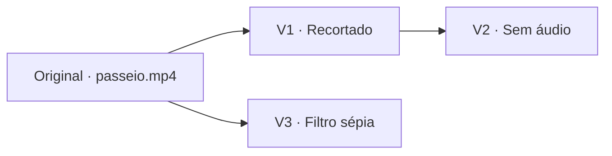

# Melhorias da interface de vídeo

> Documento de base anterior à B008. A intervenção UI-VID-01 a UI-VID-12 foi autorizada pelas D-91/D-92 em `docs/specsDuvidas.md`; a aceitação final depende dos testes manuais no browser. As três ações da B008 e os mini grupos dos resultados de junção e Movie Maker fazem parte desta intervenção.

**Data:** 23 de outubro de 2026

**Estado:** documento de base; implementação em validação manual.

**Base:** três capturas fornecidas pelo utilizador e leitura do frontend e dos contratos de vídeo existentes.

## 1. Objetivo

Organizar as ferramentas de vídeo numa área de edição coerente, aproveitar o espaço central do projeto e tornar evidente a relação entre o vídeo original e os resultados das operações. Este documento reúne os problemas, a proposta de interface, os cuidados técnicos e os cenários de validação.

O pedido foi esclarecido como **apenas documentação**. As propostas abaixo não são funcionalidades já implementadas, decisões de arquitetura aprovadas ou alterações aos requisitos existentes.

## 2. Problemas observados

| ID | Problema | Evidência | Efeito para o utilizador |
|---|---|---|---|
| UI-VID-01 | Ferramentas acumuladas em várias filas de botões sob o leitor. | Captura 1; `VideoPlayer` monta blocos separados de edição básica, edição visual e conversão. | É difícil descobrir as operações e perceber a sua organização. |
| UI-VID-02 | A edição de vídeo ocupa um diálogo enquanto a área central do projeto fica disponível. | Capturas 1 e 2; o cartão de vídeo abre um `Dialog` em `ProjectVideoList`. | O leitor compete com os controlos pelo espaço e a edição exige abrir mais diálogos. |
| UI-VID-03 | O projeto mostra «Add some images to start.» apesar de já conter vídeo. | Captura 2; o estado vazio pertence a `ProjectImageList`. | A interface sugere que o projeto está vazio e orienta apenas para imagens. |
| UI-VID-04 | Original e resultados aparecem como cartões independentes, com miniaturas e nomes semelhantes. | Captura 3; a galeria usa diretamente a lista de vídeos concluídos. | Uma transformação pode parecer um upload duplicado; não se percebe de que vídeo veio o resultado. |
| UI-VID-05 | Não há sequência visual de origem e derivações na lista. | A listagem da API está ordenada do mais recente para o mais antigo e não fornece os campos de proveniência usados no detalhe. | É difícil continuar a edição a partir da versão pretendida. |
| UI-VID-06 | A lista lateral trunca os nomes e não destaca o vídeo aberto. | Capturas 2 e 3; `ProjectVideoList` não aplica um estilo de seleção ao cartão. | É difícil distinguir ficheiros e manter o contexto. |
| UI-VID-07 | Os controlos de imagem continuam a ocupar espaço num projeto usado para vídeo. | Captura 2; `Toolbar`, `ProjectImageList` e `ProjectVideoList` são montados em paralelo. | Ações de imagem e vídeo parecem pertencer ao mesmo fluxo. |

Miniaturas iguais, por si só, **não comprovam duplicação de ficheiros**: remover áudio ou converter formato pode manter o mesmo fotograma. O problema confirmado é a falta de identificação e organização dos resultados.

## 3. Organização proposta

### 3.1. Área central para trabalhar com vídeo

Ao selecionar um vídeo, mostrar o leitor na área central do projeto, com as ferramentas do vídeo selecionado e um painel de parâmetros. Manter o acesso às imagens através de um seletor «Imagens / Vídeos» em projetos mistos, sem esconder conteúdo existente.

- Num projeto apenas com vídeos, abrir a área de vídeo em vez do estado vazio de imagens.
- Num projeto vazio, apresentar «Adiciona imagens ou vídeos para começar», com as ações permitidas para a conta.
- Ao trocar de imagem para vídeo, apresentar os controlos correspondentes ao tipo de recurso.
- O botão de aplicação das ferramentas de imagem não deve parecer executar operações de vídeo.
- Dar ao upload de vídeo uma entrada explícita: «Adicionar vídeo». Manter a indicação dos limites do perfil.
- Reservar o diálogo do leitor para uma visualização ampliada opcional; a proposta é que deixe de ser o local obrigatório de edição.

Esboço indicativo para desktop:

```text
Projeto: teste                         [Imagens] [Vídeos] [Adicionar vídeo]
┌─────────────────────┬─────────────────────────┬──────────────────────┐
│ Vídeos e versões    │ Leitor do selecionado   │ Ferramentas de vídeo │
│                     │                         │                      │
│ Original: passeio   │ passeio.mp4             │ Tempo e áudio        │
│ ├─ Original         │ [vídeo e controlos]     │ Imagem               │
│ ├─ V1 · Recorte     │                         │ Sobreposição         │
│ │  └─ V2 · Sem áudio│ Origem: V1              │ Formato              │
│ └─ V3 · Filtro      │                         │                      │
│                     │ [Informações]           │ [parâmetros]         │
│ Outro original      │ [Descarregar]           │ [Criar resultado]    │
├─────────────────────┴─────────────────────────┴──────────────────────┤
│ Tarefa do projeto: estado, progresso e cancelamento                 │
└────────────────────────────────────────────────────────────────────┘
```

A posição exata das colunas é uma sugestão. O essencial é o leitor ter espaço útil, as ferramentas terem uma organização única e a relação entre vídeos permanecer visível. Em ecrãs pequenos, usar separadores «Leitor», «Ferramentas» e «Versões», preservando a seleção.

### 3.2. Ferramentas agrupadas por finalidade

| Grupo | Operações existentes | Comportamento proposto |
|---|---|---|
| Tempo e áudio | Recortar, Velocidade, Remover áudio | Abrir os parâmetros no painel de edição. Indicar quando o vídeo já não tem áudio. |
| Imagem | Ajustar, Filtros, Redimensionar, Rodar / espelhar | Manter a pré-visualização e as validações já disponíveis para cada operação. |
| Sobreposição | Marca de água | Mostrar os controlos de texto/imagem e a respetiva pré-visualização. |
| Formato | Converter formato | Mostrar o formato atual, os destinos e a indicação de cópia ou recodificação fornecida pelo servidor. |

«Informações» e «Descarregar» ficam junto do leitor, separados das transformações. Cada operação apresenta o recurso a que se aplica, os parâmetros, o custo aplicável e a ação de confirmação. Mudar de grupo não deve iniciar processamento.

Este agrupamento não transforma várias operações numa execução única. A composição de uma cadeia e a junção de clips pertencem ao B008.

### 3.3. Original e resultados na mesma família

Mostrar um grupo por vídeo original, com as suas derivações logo abaixo. O original mantém um selo «Original» e cada resultado recebe um rótulo de apresentação, por exemplo «V1 · Recortado» ou «V2 · Sem áudio».

Regras propostas:

1. Usar os IDs e a proveniência guardada para associar recursos. Nunca agrupar apenas pelo nome, extensão ou miniatura.
2. Mostrar os resultados pela ordem de criação dentro da família, com um critério estável de desempate por ID. Os rótulos V1/V2 são de apresentação, não novos identificadores persistidos.
3. Mostrar a origem imediata de cada resultado. Se duas operações partirem do original, apresentar duas ramificações; não fingir que a segunda foi aplicada à primeira.
4. Uma operação sobre um resultado continua na família do original e mostra a cadeia de origens. Expandir/recolher a família para evitar listas extensas.
5. Depois da conclusão, atualizar a família e destacar o novo resultado com a ação «Abrir resultado». Manter o vídeo atual até o utilizador escolher mudar, para não interromper a reprodução.
6. Identificar claramente o cartão selecionado. Disponibilizar o nome completo por foco/expansão, além do texto abreviado.
7. Mostrar duração, formato real e resumo da operação. Os rótulos de versão não alteram os nomes armazenados nem o contrato de nomes para download.
8. Quando a origem já não existir, manter o resultado acessível com «Origem removida», sem o classificar automaticamente como original.
9. Preparar a apresentação para resultados com várias origens: indicar «Junção de N clips» e permitir consultar as fontes. O mesmo resultado não deve ser duplicado como se fossem ficheiros diferentes.

Exemplo de derivações:



A sequência proposta é um histórico navegável de resultados. Uma linha temporal de montagem, reprodução automática de vários vídeos ou concatenação física dos ficheiros exigiria outro comportamento e não é assumida neste documento.

## 4. Ajustes complementares

| ID | Ajuste | Critério de aceitação |
|---|---|---|
| UI-VID-08 | Estado de processamento único por projeto. | O progresso continua visível ao trocar de ferramenta ou vídeo; operações incompatíveis com uma tarefa ativa ficam indisponíveis com motivo explícito. O servidor continua a validar o limite de uma tarefa. |
| UI-VID-09 | Atualizar o contador de operações diárias. | Refletir a quota efetiva após aceitação e devoluções confirmadas, sem debitar novamente na conclusão. Este problema está documentado na D-74. |
| UI-VID-10 | Mensagens e estados consistentes. | Usar português nos novos textos, mostrar carregamento/erro/sem resultados e distinguir a ausência de vídeos de uma falha ao carregar a lista. |
| UI-VID-11 | Preservar a seleção durante atualizações. | Atualizações por WebSocket e renovação de URLs não mudam o vídeo selecionado. Se este deixar de existir, mostrar um estado explícito e permitir escolher outro. |
| UI-VID-12 | Acessibilidade e adaptação ao ecrã. | Navegação por teclado, foco visível, nomes acessíveis nos ícones, avisos de progresso e acesso às ações sem depender apenas do hover. Vídeos verticais e horizontais mantêm a proporção. |

O leitor atual monta sessões separadas para edição básica, edição visual e conversão. A existência desses blocos não prova que todos os estados estejam dessincronizados; a proposta exige validar e coordenar o bloqueio e o progresso ao nível do projeto.

## 5. Impacto técnico a considerar numa implementação futura

| Área | Código atual relevante | Trabalho previsto |
|---|---|---|
| Área de trabalho | [Página do projeto](../frontend/app/dashboard/[pid]/page.tsx), [lista de imagens](../frontend/components/project-page/project-image-list.tsx), [lista lateral de vídeos](../frontend/components/video/project-video-list.tsx) | Seleção de tipo de recurso, estado vazio correto e montagem da área de vídeo. |
| Leitor e ferramentas | [Leitor](../frontend/components/video/video-player.tsx), [edição básica](../frontend/components/video/video-edit-actions.tsx), [edição visual](../frontend/components/video/video-visual-actions.tsx), [conversão](../frontend/components/video/video-convert-actions.tsx) | Agrupamento visual, painel de parâmetros e indicação do recurso selecionado. |
| Galeria e upload | [Janela de vídeos](../frontend/components/video/video-section.tsx), [galeria](../frontend/components/video/video-gallery.tsx), [API frontend](../frontend/lib/videos.ts) | Uma seleção coerente e a mesma organização por famílias nos pontos de acesso. |
| Proveniência | [Modelo Video](../projects/models/video.js), [informação do vídeo](../projects/video/access.js), [listagem](../projects/routes/videos.js), [contrato de detalhe](../frontend/lib/video-access.ts) | Disponibilizar os dados necessários para formar famílias e distinguir operações. |
| Tarefas e quota | [Sessão de edição](../frontend/components/video/use-video-edit.ts), [acompanhamento de tarefa](../frontend/components/video/use-video-task.ts) | Coordenar estado, seleção, atualização da galeria e atualização da quota. |

### Dados disponíveis e lacuna da listagem

O modelo já guarda `source_video_ids`, `recipe` e `task_id`. O endpoint de detalhe devolve `sources` e `recipe`. Porém, o tipo `ProjectVideo` e a listagem atual apenas fornecem os dados do cartão, sem essa proveniência.

Assim, agrupar corretamente os resultados requer mais do que CSS: será necessário disponibilizar a proveniência à galeria. No desenho técnico, escolher uma extensão aditiva da listagem ou um contrato complementar em lote. Evitar uma chamada de detalhe por cartão como solução permanente e não reconstruir relações a partir de nomes.

Os campos novos, se existirem, devem preservar os consumidores atuais, as permissões de projeto/partilha e a compatibilidade com vídeos históricos. Não é necessária uma nova cópia dos ficheiros para apresentar versões. A ordenação por família pode ser uma projeção dos recursos existentes.

### Regras e decisões existentes

- Respeitar a regra 2.6 do [ADD](add.md): a proposta de reorganização não autoriza, por si só, substituir código existente. O plano de implementação deve definir os pontos de extensão e identificar qualquer alteração que necessite de decisão da equipa.
- Rever a apresentação definida nas D-31/D-32 caso a edição deixe de ser centrada no diálogo e na lista lateral. Registar a decisão antes de a considerar substituída.
- Preservar as regras de quota, cancelamento, acesso anónimo, partilha e validação no servidor.
- Respeitar a D-75: novos resultados apresentam a extensão real; os nomes históricos não foram migrados. O selo de formato deve usar os metadados reais.
- Tratar a D-74 como dívida de atualização do contador, sem alterar a cobrança do servidor.
- Não acrescentar ferramentas ainda fora do âmbito aprovado nem antecipar a implementação do B008 através desta melhoria visual.

As decisões referidas estão em [specsDuvidas.md](specsDuvidas.md). Este documento não as modifica.

## 6. Fixtures e cenários para validar a futura UI

Esta secção especifica os dados de teste necessários; **não foram geradas novas fixtures nem executados testes nesta intervenção documental**. Preferir vídeos sintéticos pequenos, gerados com FFmpeg, em contas e projetos exclusivos da execução, com limpeza no final.

| Fixture/cenário | Preparação | Resultado esperado |
|---|---|---|
| Projeto vazio | Sem imagens nem vídeos. | Mensagem e ações adequadas aos dois tipos de conteúdo e às permissões. |
| Apenas vídeo vertical | Um original MP4 com áudio. | Área central de vídeo, proporção preservada e ausência do pedido para adicionar imagens. |
| Projeto misto | Uma imagem e um vídeo horizontal. | Trocar de tipo mantém o conteúdo e apresenta as ferramentas correspondentes. |
| Resultados sucessivos | Original → recorte → remoção de áudio. | Uma família com três recursos e origem imediata correta em cada resultado. |
| Ramificação | Aplicar filtro ao original, além da sequência anterior. | Resultado ligado ao original, sem o apresentar como descendente da remoção de áudio. |
| Nomes e miniaturas iguais | Dois uploads independentes com o mesmo nome; uma conversão que conserva o fotograma inicial. | Uploads independentes em famílias distintas; conversão identificada pela sua origem e formato. |
| Conversão e nomes antigos | Resultados MP4/MOV/AVI, incluindo um registo histórico com extensão apresentada antiga. | Formato real visível e download coerente com o contrato existente. |
| Ausência de áudio | Original ou resultado sem faixa de áudio. | «Remover áudio» indisponível com explicação. |
| Tarefa ativa e conclusão | Iniciar operação e trocar de ferramenta/vídeo; concluir ou cancelar. | Progresso persistente, bloqueios coerentes, quota atualizada e resultado disponível sem interrupção automática do leitor. |
| Falhas | Simular erro de listagem, de upload e de processamento. | Mensagens distintas, sem confundir erro com lista vazia nem apresentar resultado concluído inexistente. |
| Origem removida | Resultado válido cujo vídeo de origem já não existe. | Resultado acessível com indicação «Origem removida». |
| Várias origens | Dados sintéticos de proveniência de uma junção, para o desenho do B008. | Fontes consultáveis sem duplicar artificialmente o resultado; não equivale a testar o processamento do B008. |
| Lista extensa e ecrã pequeno | Vários originais e famílias com muitas versões. | Famílias recolhíveis, nomes acessíveis, foco e seleção preservados. |
| Leitura/edição e quota | Conta free, Premium e partilha read/edit. | Controlos e mensagens coerentes com a permissão e quota reais. |

## 7. Ordem sugerida e conclusão futura

1. **Prioridade alta:** distinguir os recursos na galeria, mostrar a relação original/resultados e corrigir o estado vazio quando há vídeo.
2. **Prioridade alta:** organizar as ferramentas por finalidade e apresentar de forma inequívoca o vídeo selecionado.
3. **Prioridade seguinte:** colocar a edição na área central, coordenando o seletor Imagens/Vídeos e a apresentação em ecrãs pequenos.
4. **Prioridade seguinte:** consolidar progresso/bloqueio e resolver a atualização visual da quota, com regressão das operações existentes.

A implementação só deve ser considerada concluída depois de validar os cenários aplicáveis no navegador, testar a formação das famílias e comprovar que os fluxos de imagem, vídeo, partilha e download continuam a funcionar. Reutilizar as suites existentes e acrescentar verificações dos comportamentos novos, sem presumir aprovação a partir desta análise.

**Entregável desta intervenção:** apenas este documento. Nenhum código da aplicação, dado, serviço ou configuração foi alterado.
