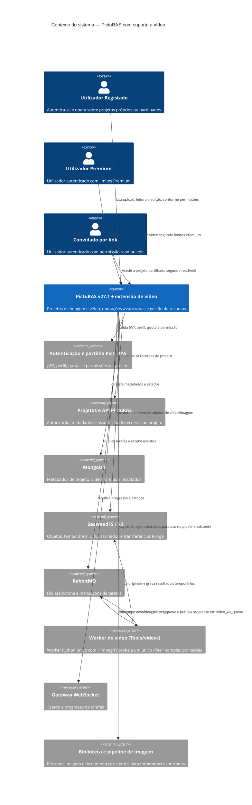

# Suporte a vídeo — Contexto do sistema

## Visão geral

A intent estende o PictuRAS v27.1, aplicação web de edição de imagens, para armazenar, consultar, reproduzir e processar vídeos dentro de projetos. A extensão reutiliza os mecanismos de autenticação e partilha, projetos, armazenamento, filas, tarefas, WebSockets e imagens existentes. Acrescenta o domínio de vídeo e o worker de processamento descritos no ADD v1.1 e na ERS v2.4, seguindo a regra 2.6 do ADD ("só acrescentar"): o código existente não é alterado e o vídeo liga-se por ficheiros e pontos de ligação novos.

O limite do sistema neste artefacto é o PictuRAS completo, incluindo a extensão especificada. A implementação de vídeo ainda não existe no código analisado; as relações abaixo representam contexto e integrações requeridas, não componentes de vídeo já implementados.

## Atores

- **Utilizador Registado** (humano): autentica-se, carrega vídeos e inicia operações em projetos onde tem permissão de edição; está sujeito à quota diária e aos limites de perfil definidos na ERS.
- **Utilizador Premium** (humano): executa as mesmas funcionalidades, com limites alargados e sem quota diária de processamento.
- **Convidado por link** (humano autenticado): acede a projeto partilhado com a permissão associada ao link; leitura permite consultar e descarregar, edição permite carregar e transformar. Quota e limites seguem a conta autenticada que executa a operação.
- **Anónimo**: excluído das funcionalidades de vídeo.

## Diagrama de contexto

## Integrações

| Sistema / componente existente ou requerido | Direção e dados | Papel no contexto |
|---|---|---|
| Autenticação JWT e partilha | Entrada: identidade, perfil e permissão read/edit; saída: pedidos autorizados | `videoAuth` novo no router de vídeo do gateway (401 sem JWT válido, 403 se o utilizador do token não for o do caminho); `checkSharePermission`, `requireEditPermission` e `enforcePresenceLimit` reutilizados tal como estão; `anonymous` recusado com 403 (ADD T-00, T-03). |
| API e serviço de projetos | Ambos: pedidos, IDs de recursos, metadados e resultados | Routers novos `apiGateway/routes/videos.js` e `projects/routes/videos.js` (rotas `/projects/:user/:project/videos/…`), registo de operações, plano de execução, módulo AMQP de vídeo e rotina da Q-ADD-14 (ADD T-00, T-01, T-03). |
| MongoDB | Ambos: metadados, estados, resultados e proveniência | Coleções novas `videos`, `VideoTask` e `video_project_locks` no serviço de projetos e predefinições de vídeo no serviço de utilizadores; o modelo `Process` não muda (ADD T-00, T-03, T-09, 4.9). |
| SeaweedFS/S3 e `imageStorageService` | Ambos: binários, URLs assinados e intervalos Range | Módulo de vídeo novo (`videoStages.js`, `videoUrls.js`, `route/video.js`): URL de leitura de 15 min, URL de escrita interno para o worker; servido pelo `location /s3-video/` novo do nginx (ADD T-08, 4.10). |
| RabbitMQ | Saída/entrada assíncrona: pedido, progresso, cancelamento e resultado da tarefa | Filas novas `video_operations_queue` (*quorum*, limite de entregas e *dead-letter*), `video_project_queue` e `video_ws_queue`, e exchange *fanout* `video_control`; o vídeo não usa `project_queue` nem `ws_queue` (ADD T-00, T-03). |
| Worker de vídeo `Tools/video/` | Entrada: tarefa com o plano de execução e as chaves dos objetos; saída: estado, progresso, erro e metadados do resultado | Executa o plano calculado no serviço de projetos num único `-filter_complex`, sem validar regras de negócio (ADD T-01, T-02). |
| Gateway WebSocket | Saída para cliente: estados e progresso | Módulo novo `wsGateway/video.js` com `video-task-update` para a sala do utilizador e `project:<id>` (ADD T-03). |
| Biblioteca e ferramentas de imagem | Ambos: imagens extraídas, metadados e referência de proveniência | Fotogramas passam a ser recursos de imagem normais; as ferramentas de imagem não processam vídeo. |

## Fluxos de dados

### Entrada

1. O utilizador envia um pedido autenticado com identificador de projeto, recurso(s) e parâmetros da operação; uploads trazem um ficheiro binário local.
2. O PictuRAS valida JWT, permissão de projeto, perfil, matriz de contentor/codec, limites e parâmetros antes de admitir a tarefa.
3. Para uma operação assíncrona, o serviço de projetos calcula o plano de execução, adquire o lugar de tarefa ativa, reserva a quota (exceto Premium), cria a `VideoTask` e publica na `video_operations_queue` uma mensagem com o `correlationId` no corpo (ADD T-03, T-04, T-10).
4. O worker pede os URLs internos, descarrega o original e executa o plano de acordo com as regras de operação, cadeia.

### Saída

1. Uploads válidos produzem recurso de vídeo e metadados no projeto; reprodução usa o recurso/preview permitido.
2. O worker publica o progresso pelo menos 1×/s em `video_ws_queue` e responde em `video_project_queue`; o serviço de projetos grava o estado e, em sucesso, cria o recurso derivado (a reserva de quota torna-se definitiva, Q-ADD-03); em falha ou cancelamento, devolve os créditos, não altera o original e remove os temporários e resultados não publicados.
3. O cliente consulta estado e metadados, ou descarrega um vídeo concluído através de URL temporário do storage, sem encaminhar o binário pelo API Gateway.
4. Numa cadeia, apenas o resultado final é publicado.

## Restrições de contexto

- Usar a baseline PictuRAS v27.1 e preservar o comportamento das ferramentas/filas de imagem.
- Só utilizadores Registados, Premium e convidados autenticados com permissão adequada podem aceder; leitura é suficiente apenas para consulta e download.
- A matriz de formatos/codecs, limites por perfil, custos de quota e exceções são os da ERS v2.4 e das decisões DQ correspondentes, e o desenho é o do ADD v1.1; não redefinir no código.
- Regra 2.6 do ADD: não alterar linhas existentes nem o comportamento do fluxo de imagem; só ficheiros e pontos de ligação novos.
- Uma tarefa ativa de vídeo por projeto; processamento assíncrono; cadeia atómica.
- Não modificar o original nem publicar resultados parciais; ligar recursos derivados à origem e ao projeto.
- Upload, reprodução, pré-visualização, consulta e download não consomem créditos de processamento.

## Objetivos NFR de contexto

- A API confirma a aceitação de uma tarefa em até 1 segundo; o processamento ocorre fora do pedido síncrono.
- Autorização JWT e de projeto é verificada antes da emissão de URLs ou acesso aos recursos.
- Binários grandes são servidos diretamente pelo storage com URLs assinados temporários e retoma Range quando requerida.
- O `correlationId` é gerado no router de vídeo do gateway e viaja no cabeçalho `X-Correlation-Id`, no corpo das mensagens de vídeo e nas respostas de erro; o progresso WebSocket é emitido pelo menos 1×/s em todas as operações.
- Critérios quantificados e exceções completos permanecem nos requisitos `REQ-VID-NFR-*`; este resumo não os substitui.

## Referências de origem

- Arquitetura: `docs/add.md` (ADD v1.1, documento mestre).
- ERS: `docs/requirements.md` (v2.4) e `docs/requirements/`.
- Casos de uso: `docs/use-cases/UC-VID-000.md` a `.md` (índice v1.5).
- Decisões e contexto do domínio: `docs/inception/artefactos-finais.md` e capítulos 2–3 do relatório.
- Impacto nos componentes existentes: capítulo 6; rastreabilidade ERS e baseline: capítulo 7.
