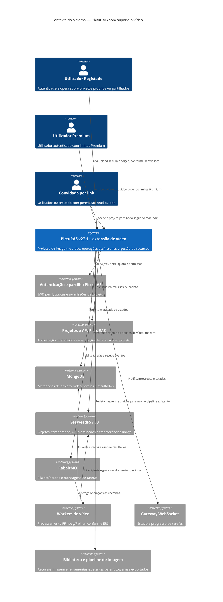

# Suporte a vídeo — Contexto do sistema

## Visão geral

A intent estende o PictuRAS v27.1, aplicação web de edição de imagens, para armazenar, consultar, reproduzir e processar vídeos dentro de projetos. A extensão reutiliza os mecanismos de autenticação e partilha, projetos, armazenamento, filas, tarefas, WebSockets e imagens existentes. Acrescenta o domínio de vídeo e os workers de processamento descritos na ERS; não altera as ferramentas de imagem para receberem vídeos.

O limite do sistema neste artefacto é o PictuRAS completo, incluindo a extensão especificada. A implementação de vídeo ainda não existe no código analisado; as relações abaixo representam contexto e integrações requeridas, não componentes de vídeo já implementados.

## Atores

- **Utilizador Registado** (humano): autentica-se, carrega vídeos e inicia operações em projetos onde tem permissão de edição; está sujeito à quota diária e aos limites de perfil definidos na ERS.
- **Utilizador Premium** (humano): executa as mesmas funcionalidades, com limites alargados e sem quota diária de processamento.
- **Convidado por link** (humano autenticado): acede a projeto partilhado com a permissão associada ao link; leitura permite consultar e descarregar, edição permite carregar e transformar. Quota e limites seguem a conta autenticada que executa a operação.
- **Anónimo**: excluído das funcionalidades de vídeo.

## Diagrama de contexto

## Integrações

| Sistema / componente existente ou requerido | Direção e dados | Papel no contexto |
|---|---|---|
| Autenticação JWT e partilha | Entrada: identidade, perfil e permissão read/edit; saída: pedidos autorizados | Distingue acesso autenticado, perfil e permissão do projeto. |
| API e serviço de projetos | Ambos: pedidos, IDs de recursos, metadados e resultados | Valida projeto e associa recursos e tarefas ao projeto. |
| MongoDB | Ambos: metadados, estados, resultados e proveniência | Persiste o catálogo lógico; não armazena os binários de vídeo. |
| SeaweedFS/S3 | Ambos: binários, temporários, URLs assinados e intervalos Range | Guarda ficheiros e serve transferências diretas autorizadas. |
| RabbitMQ | Saída/entrada assíncrona: pedido, progresso e resultado da tarefa | Desacopla API e processamento; fila de vídeo independente da fila de imagem. |
| Workers de vídeo (FFmpeg/Python) | Entrada: tarefa e referência ao recurso; saída: estado, erro e recursos gerados | Executa validação/processamento segundo operações e restrições da ERS. |
| Gateway WebSocket | Saída para cliente: estados e progresso aplicável | Mantém o utilizador informado sem bloquear a navegação. |
| Biblioteca e ferramentas de imagem | Ambos: imagens extraídas, metadados e referência de proveniência | Fotogramas passam a ser recursos de imagem normais; as ferramentas de imagem não processam vídeo. |

## Fluxos de dados

### Entrada

1. O utilizador envia um pedido autenticado com identificador de projeto, recurso(s) e parâmetros da operação; uploads trazem um ficheiro binário local.
2. O PictuRAS valida JWT, permissão de projeto, perfil, matriz de contentor/codec, limites e parâmetros antes de admitir a tarefa.
3. Para uma operação assíncrona, a API reserva quota quando aplicável, regista a tarefa e coloca uma mensagem com correlação na fila de vídeo.
4. O worker lê o original do storage e executa o trabalho de acordo com as regras de operação, cadeia ou lote.

### Saída

1. Uploads válidos produzem recurso de vídeo e metadados no projeto; reprodução usa o recurso/preview permitido.
2. O worker reporta estados, progresso e falhas pelos mecanismos definidos. Em sucesso, regista recurso derivado ou imagens extraídas; em falha/cancelamento, não altera o original e remove resultados temporários não publicados.
3. O cliente consulta estado e metadados, ou descarrega um vídeo concluído através de URL temporário do storage, sem encaminhar o binário pelo API Gateway.
4. Em lote, os resultados concluídos são independentes; em cadeia, apenas o resultado final é publicado.

## Restrições de contexto

- Usar a baseline PictuRAS v27.1 e preservar o comportamento das ferramentas/filas de imagem.
- Só utilizadores Registados, Premium e convidados autenticados com permissão adequada podem aceder; leitura é suficiente apenas para consulta e download.
- A matriz de formatos/codecs, limites por perfil, custos de quota e exceções são os da ERS v2.3 e das decisões DQ correspondentes; não redefinir no código.
- Uma tarefa ativa de vídeo por projeto; processamento assíncrono; cadeia atómica; lote sequencial com resultados independentes.
- Não modificar o original nem publicar resultados parciais; ligar recursos derivados à origem e ao projeto.
- Upload, reprodução, pré-visualização, consulta e download não consomem créditos de processamento.

## Objetivos NFR de contexto

- A API confirma a aceitação de uma tarefa em até 1 segundo; o processamento ocorre fora do pedido síncrono.
- Autorização JWT e de projeto é verificada antes da emissão de URLs ou acesso aos recursos.
- Binários grandes são servidos diretamente pelo storage com URLs assinados temporários e retoma Range quando requerida.
- Eventos propagam `correlationId`; progresso WebSocket respeita a cadência definida para cada operação.
- Critérios quantificados e exceções completos permanecem nos requisitos `REQ-VID-NFR-*`; este resumo não os substitui.

## Referências de origem

- ERS: `docs/requirements.md` e `docs/requirements/`.
- Casos de uso: `docs/use-cases/UC-VID-000.md` a `UC-VID-015.md`.
- Decisões e contexto do domínio: `docs/inception/artefactos-finais.md` e capítulos 2–3 do relatório.
- Impacto nos componentes existentes: capítulo 6; rastreabilidade ERS e baseline: capítulo 7.
